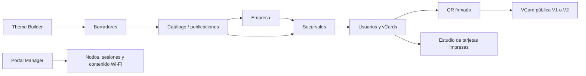

# VCards QR Suite V2

Plataforma web para gestionar tarjetas de contacto digitales, QR corporativos, temas por empresa/sucursal y un estudio de tarjetas imprimibles. Incluye un espacio administrativo de portales cautivos. Su objetivo es mantener una identidad visual consistente, preservar los enlaces QR históricos y permitir administración de múltiples compañías sin mezclar datos.

> **Estado:** la aplicación tiene un despliegue previo; los PR descritos aquí son cambios de desarrollo y **no equivalen a funciones desplegadas**. Revise el CI, QA y los informes de compatibilidad antes de integrar.

## Arquitectura y entidades

- **Frontend/backend:** Next.js 14 (App Router), TypeScript, NextAuth y rutas API internas.
- **Persistencia:** PostgreSQL mediante Prisma ORM 6.
- **Jerarquía principal:** `Company → Branch → User/VCard`. Una compañía tiene varias sucursales; el QR y su identidad se preservan al cambiar datos de perfil.
- **Temas:** `Theme` usado por vCards, portales y tarjetas físicas; deben conservarse los ámbitos/categorías para evitar contaminación entre compañías y productos.
- **Compatibilidad:** rutas públicas `/vcard/[id]` (V1) y `/v2/vcard/[id]` (V2), QR firmados y datos históricos.

### App Flow simplificado



## Módulos

| Módulo | Ruta | Función |
|---|---|---|
| Gestión de contactos y QR | `/vcards` | Crear, editar, consultar y exportar vCards |
| Empresas y sucursales | `/vcards/companias` | Asignación multiempresa y branding |
| Diseñador de temas | `/vcards/theme-builder` | Diseñar la apariencia pública de las tarjetas |
| Catálogo de temas | `/vcards/temas` | Listar, clonar, programar y publicar por ámbito |
| Estudio de impresión | `/vcards/editor` | Diseñar tarjetas CR80, frente/reverso, con QR |
| Reportes | `/reportes` | Datos de uso y escaneo |
| Portales cautivos | `/portal-admin` | Backoffice independiente (en PR) |

La implementación y disponibilidad de cada mejora depende de que el PR respectivo se revise, fusione y despliegue.

## Desarrollo local

Requisitos: Node.js compatible con Next 14, PostgreSQL y variables privadas `DATABASE_URL`, `NEXTAUTH_SECRET`, `NEXTAUTH_URL` configuradas fuera del repositorio. No reutilizar valores de CI para producción.

```bash
npm ci
npx prisma validate
npx prisma generate
npm run typecheck
npm test
npm run lint
npm run build
npm run dev
```

**No ejecutar `prisma db push`, `migrate deploy`, borrados o reinicios contra producción sin backup, plan de migración, aprobación y prueba de rollback.** El repositorio histórico puede no incluir migraciones suficientes; revise [hallazgos técnicos](docs/v2/AUDIT_FINDINGS.md).

## PR de mejoras (octubre 2026)

Los cambios se revisan por fases y no deben desplegarse todos a la vez:

| PR | Tema | Dependencia |
|---|---|---|
| [#2](https://github.com/LORDMANUEL/vcards-qr-suite-V2/pull/2) | Integridad empresa/sucursal, evitar desasociaciones y duplicaciones | main |
| [#3](https://github.com/LORDMANUEL/vcards-qr-suite-V2/pull/3) | Publicación de temas por compañía/sucursal y calendario Honduras | #2 |
| [#4](https://github.com/LORDMANUEL/vcards-qr-suite-V2/pull/4) | QR original en impresión y PDF CR80 doble cara | main |
| [#5](https://github.com/LORDMANUEL/vcards-qr-suite-V2/pull/5) | Espacio Portal Manager | main |
| [#6](https://github.com/LORDMANUEL/vcards-qr-suite-V2/pull/6) | CI, SQL read-only, manual Codex y documentación | main |
| [#7](https://github.com/LORDMANUEL/vcards-qr-suite-V2/pull/7) | Guardado reversible del Theme Builder, borradores y UX | #3 |

**Criterio de aceptación:** CI del SHA final aprobado, revisión de código, QA integrada (empresa Ford/GAC/Quick Lane), URLs/QR históricos, privacidad, datos reales en staging, respaldo/restauración, plan operacional y aprobación explícita. CI verde no implica pruebas E2E ni autorización de despliegue.

## Documentos de arquitectura y operación

- [PRD](docs/v2/PRD.md) y [TRD](docs/v2/TRD.md)
- [UI/UX](docs/v2/UI_UX_DESIGN.md), [App Flow](docs/v2/APP_FLOW.md) y [Esquema backend](docs/v2/BACKEND_SCHEMA.md)
- [Plan de desarrollo](docs/v2/DEVELOPMENT_PLAN.md), [Plan de QA](docs/v2/QA_TEST_PLAN.md) y [Hallazgos de auditoría](docs/v2/AUDIT_FINDINGS.md)
- [Cambios V2](docs/v2/CHANGELOG_V2.md), [origen del snapshot](docs/v2/SOURCE_SNAPSHOT.md) y [Rollback](docs/v2/ROLLBACK.md)
- [Instrucciones de Codex / despliegue seguro](docs/v2/CODEX_DEPLOYMENT_HANDOFF_2026-10-26.md)
- [Diagnóstico SQL solo lectura](docs/v2/RECONCILIATION_READONLY_2026-10-26.sql)
- [PR 2 integridad](docs/v2/PR01_INTEGRITY_FIX_2026-10-26.md), [PR 3 temas](docs/v2/PR03A_THEME_SCOPES_2026-10-26.md), [PR 4 impresión](docs/v2/PR06_PRINT_STUDIO_2026-10-26.md), [PR 5 portal](docs/v2/PR07A_PORTAL_WORKSPACE_2026-10-26.md), [PR 7 Theme Builder](docs/v2/PR07_THEME_BUILDER_ROUNDTRIP_2026-10-26.md)

Algunos documentos se incorporan mediante PRs independientes: sus enlaces funcionarán en `main` una vez integrados.

## Seguridad y manejo de datos

No publicar contraseñas, `.env`, respaldos, cadenas de conexión, claves de firmas QR, sesiones, correos privados o información identificable de usuarios en el repositorio. Las capturas de pruebas deben anonimizarse. Toda API de administración debe comprobar sesión y permisos; el portal público y los QR requieren pruebas separadas.

## Despliegue y continuidad

Se requiere identificar los servicios realmente activos, documentar el commit y checksum del release, construir fuera del servidor de producción, probar con copia de datos y preparar restauración. **No actualizar el portal 9301 ni el servicio vCards 9306 automáticamente.** El [runbook de Codex](docs/v2/CODEX_DEPLOYMENT_HANDOFF_2026-10-26.md) establece el orden y evidencia.

---
Proyecto mantenido en este repositorio. La documentación y el código se revisan por PR para preservar trazabilidad.
