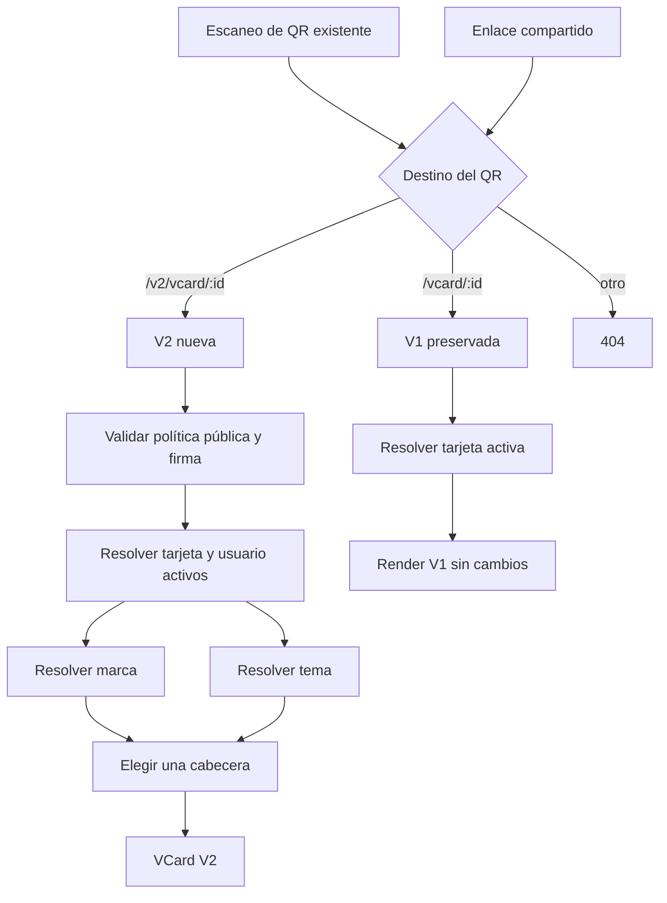
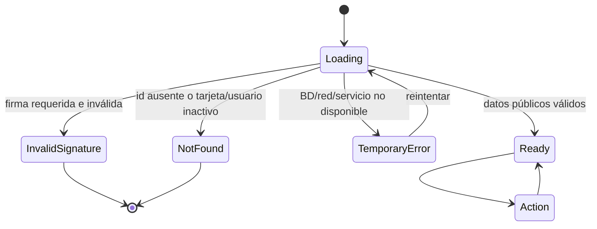
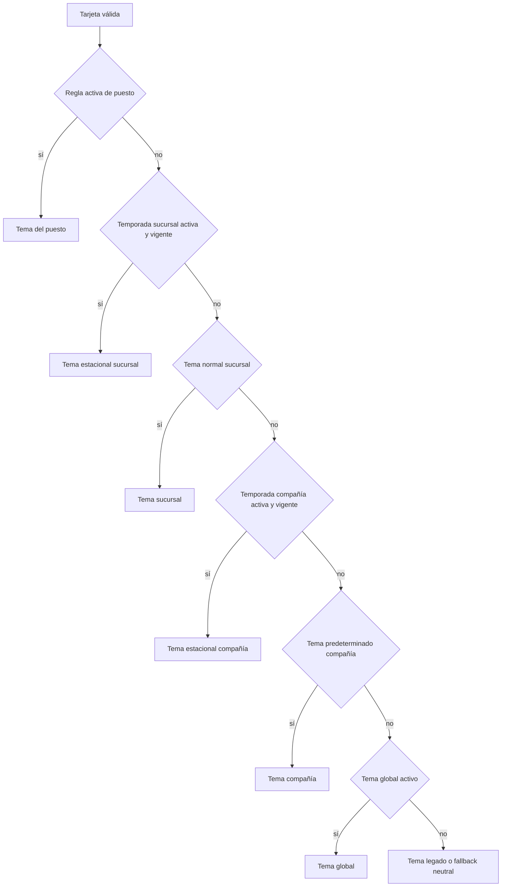
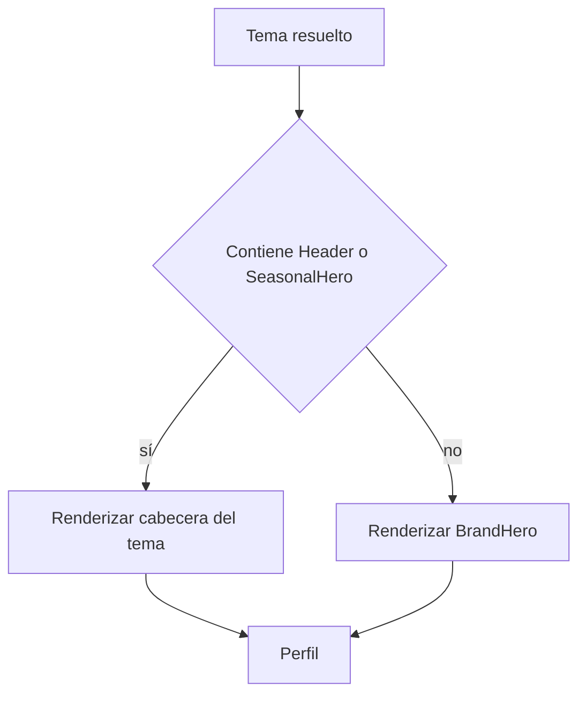
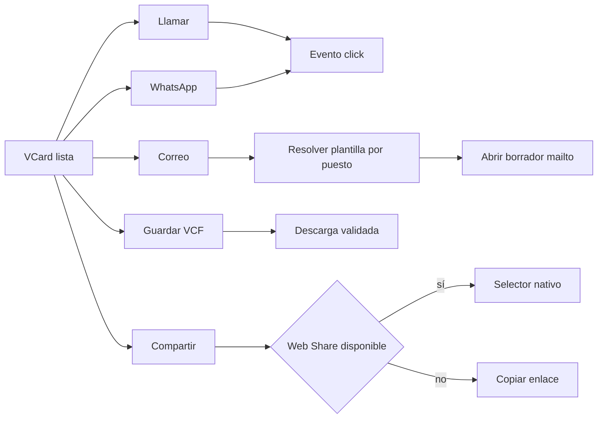
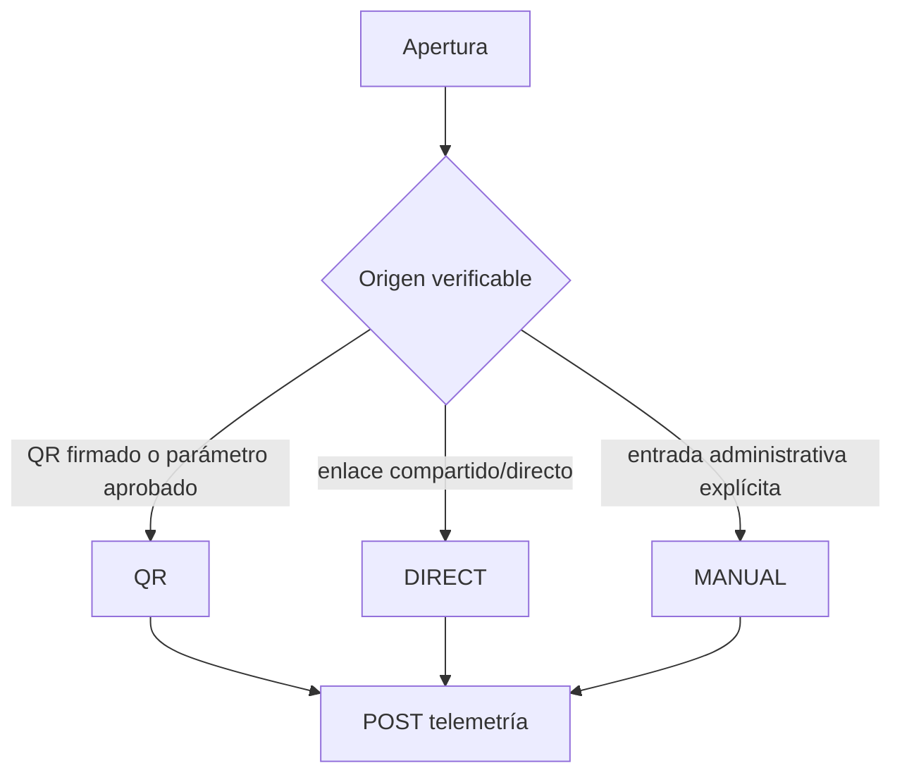
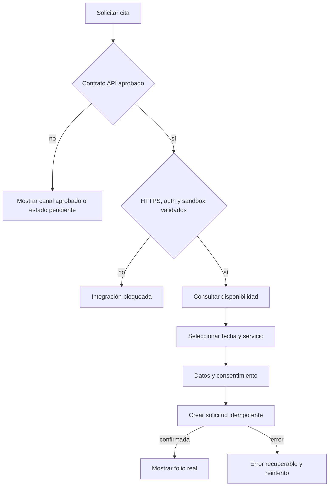

# App Flow — VCards V1, V2, QR y agenda

## Entrada pública

## Estados de resolución V2

Hoy el cliente convierte errores HTTP y de red en “vCard no encontrada”; la separación anterior es objetivo, no estado implementado.

## Selección de tema

## Composición de cabecera

## Acciones

## Atribución de visita

Estado confirmado actual: V1 y V2 envían siempre `scanMethod: QR` al montar, independientemente del origen.

## Agenda y CRM

## Flujos de error

| Caso | Respuesta esperada | Telemetría |
|---|---|---|
| Firma ausente/inválida cuando es obligatoria | 403 neutral | Evento de seguridad sin guardar firma completa |
| Tarjeta o usuario inactivo | 404 neutral | Conteo agregado, sin PII |
| API/BD temporalmente caída | 503/estado de reintento | Error correlacionado |
| Acción sin dato | Control oculto | Ninguna |
| URL de acción no permitida | Bloquear y registrar configuración inválida | Alerta administrativa |
| CRM no disponible | No confirmar cita | Error y reintento seguro |

## Compatibilidad y rutas

- `/vcard/[id]`: V1, sin redirección automática.
- `/v2/vcard/[id]`: V2 aislada.
- QR existentes: no regenerar ni alterar durante esta fase.
- `/portal` y puerto 9301: fuera del cambio.
- Promoción de QR hacia V2: decisión futura con plan de migración y rollback.

