# App Flow — Sistema VCards completo

## Propósito y leyenda

Este documento integra experiencia pública, administración, diseño/marketing, analítica, portal cautivo, operación y agenda futura. Se basa en el brief, el chat «Diseñar App Flow V2», las rutas del repositorio y la auditoría 9301/9306.

- **Actual:** flujo observado en el código.
- **Rama:** cambio implementado en `feat/vcards-v2-visual-overhaul`.
- **Futuro bloqueado:** no existe en producción y requiere aprobación.

## Mapa general

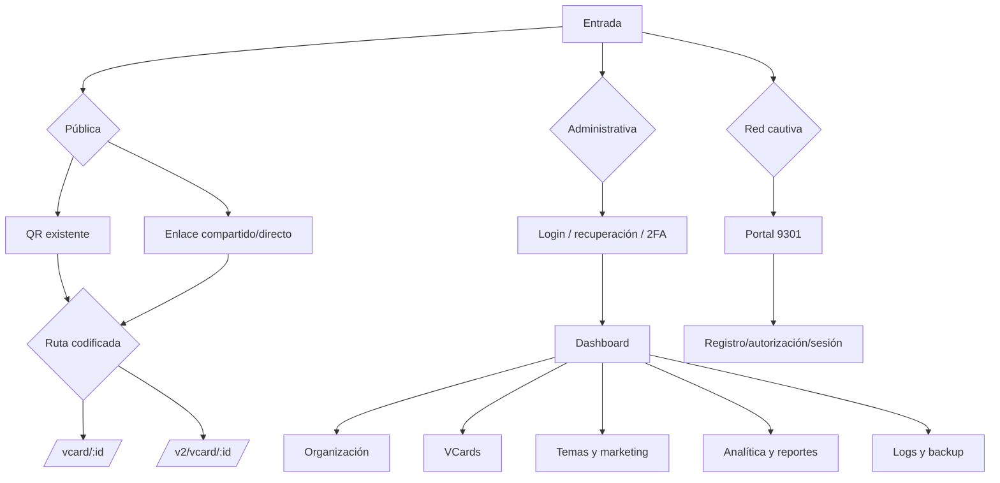

## Actores

| Actor | Acceso | Objetivo |
|---|---|---|
| Visitante | Público | Ver/contactar/guardar/compartir VCard |
| Cliente desde QR | Público con señal QR | Igual, con atribución QR |
| Usuario administrativo | Sesión | Operar según permisos |
| Diseñador/marketing | Sesión y permiso | Crear temas/campañas y preview |
| Analista | Sesión y permiso | Consultar uso y exportar |
| Operador de red | Sesión/infra | Portal cautivo, AP y sesiones |
| Servicio externo CRM | Futuro | Disponibilidad y citas |

## Flujo 1 — QR/enlace hacia V1 o V2

**Estado:** V1 actual preservada; controles V2 implementados en rama.

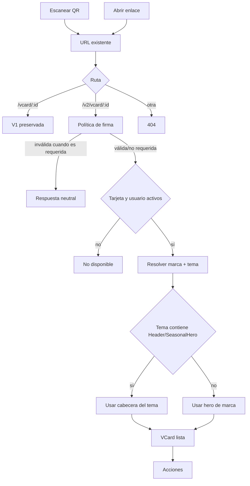

V1 mantiene su URL y comportamiento. No existe migración automática de QR a V2.

## Flujo 2 — Resolución de tema

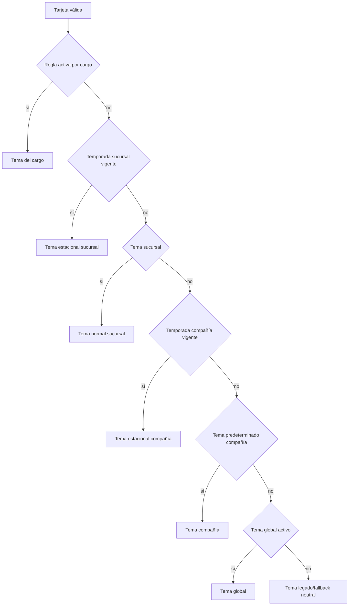

## Flujo 3 — Acciones públicas

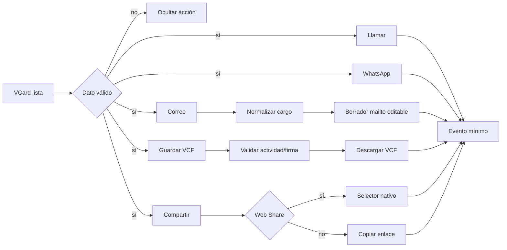

Si una URL no tiene esquema permitido, se bloquea y no se navega.

## Flujo 4 — Telemetría

**Estado de rama:** `sig` se usa como heurística QR y su ausencia como DIRECT. Al compartir una URL firmada la atribución puede seguir como QR; una señal de origen separada es trabajo futuro.

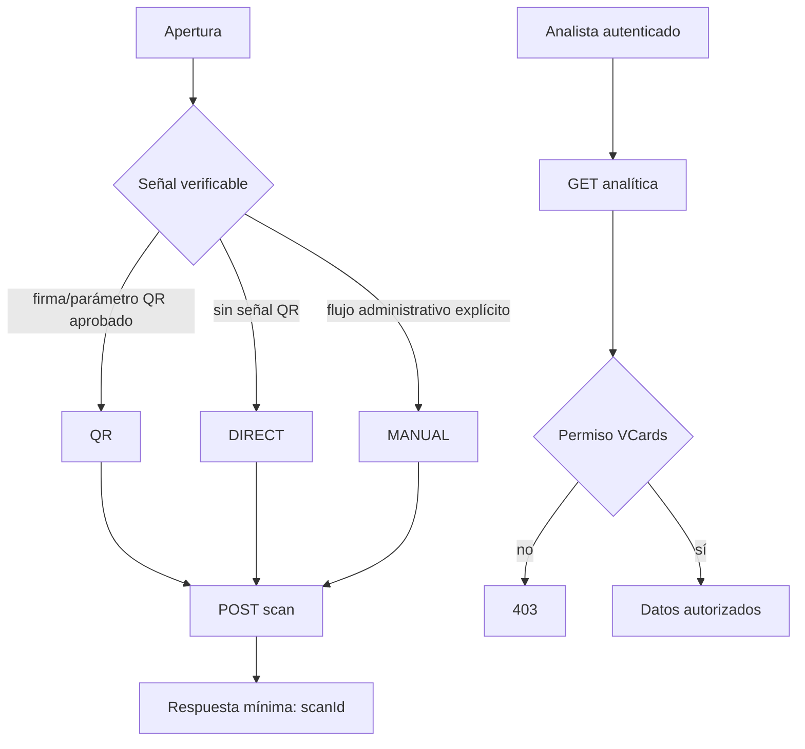

## Flujo 5 — Solicitud de cita actual

**Estado:** `mailto:` está implementado técnicamente, pero pendiente de aprobación por negocio. Sin aprobación, el CTA debe ocultarse o mostrarse no disponible.

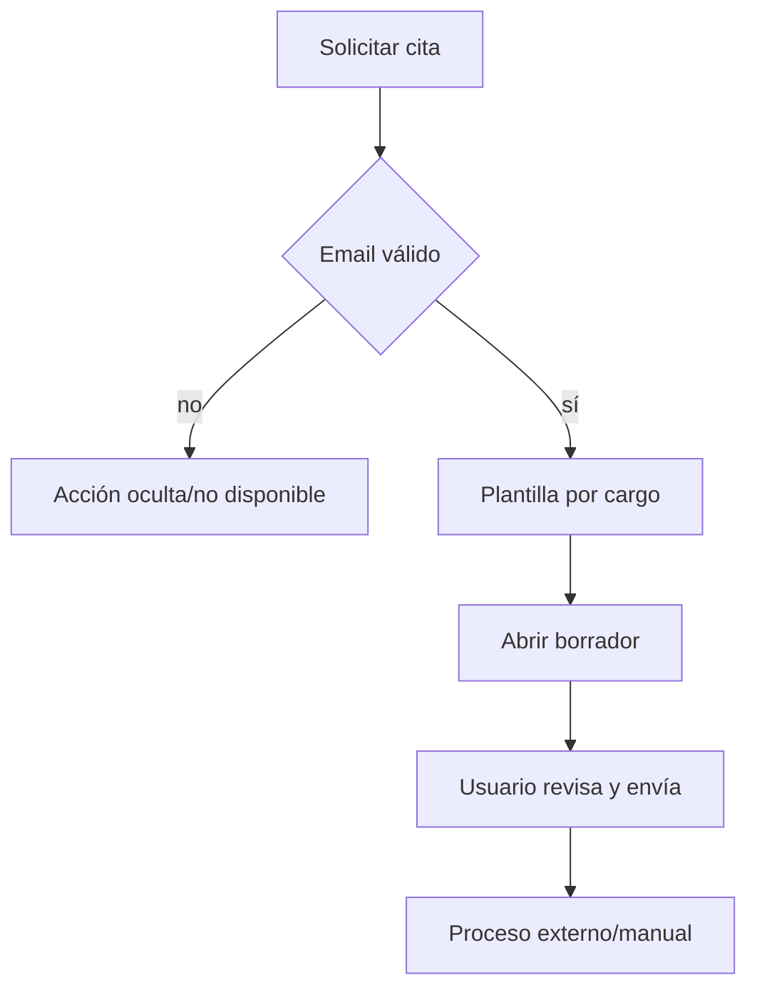

No se guarda formulario, no se consulta disponibilidad y no se confirma una cita.

## Flujo 6 — Agenda CRM futura bloqueada

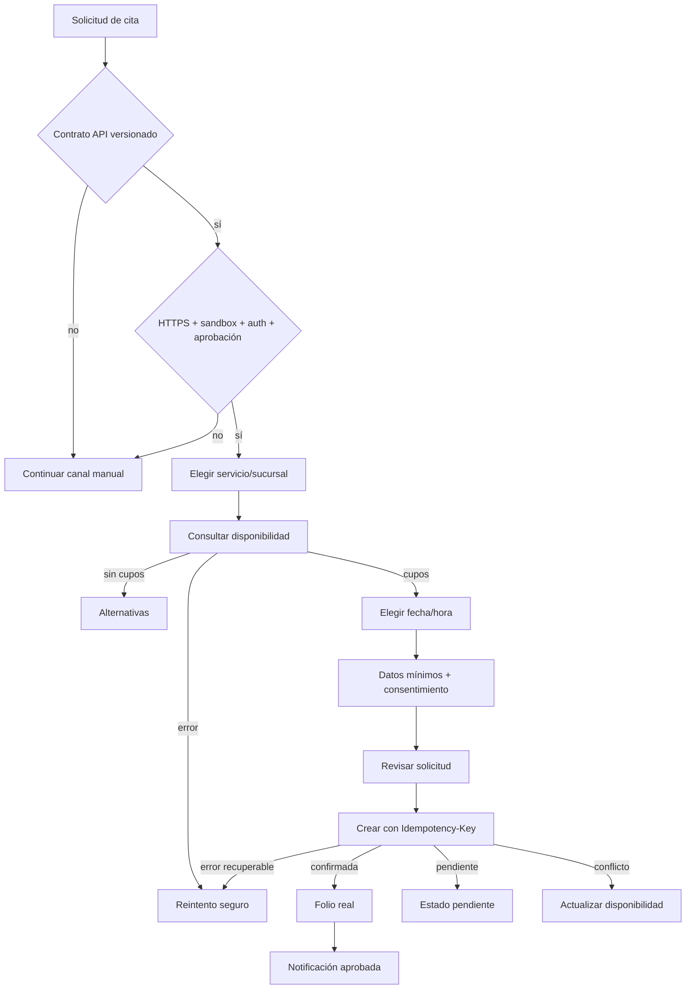

## Flujo 7 — Autenticación administrativa

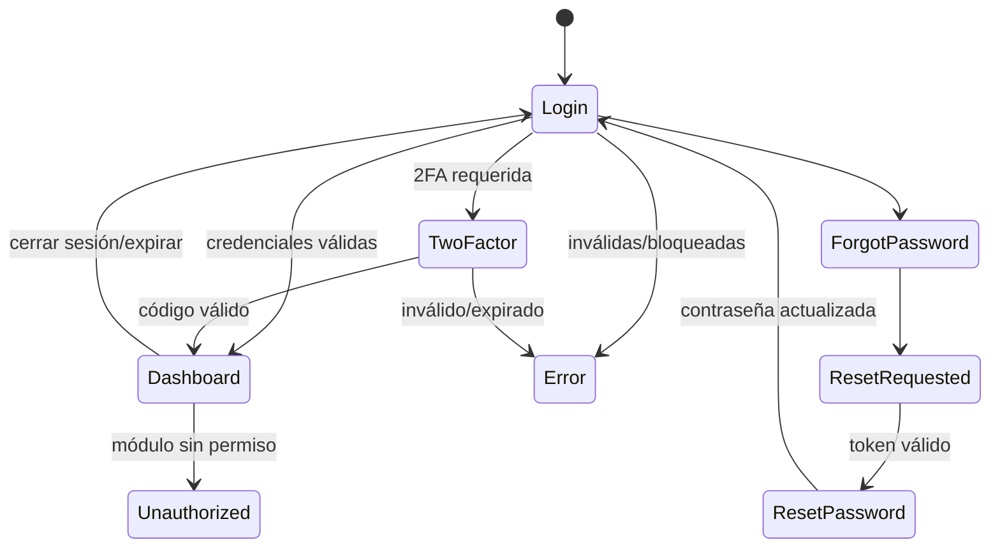

Los detalles de contraseñas, SMTP y tokens no se exponen en UI, logs ni documentación.

## Flujo 8 — Organización y VCards

**Estado:** descriptivo del código existente; no fue rediseñado en esta rama.

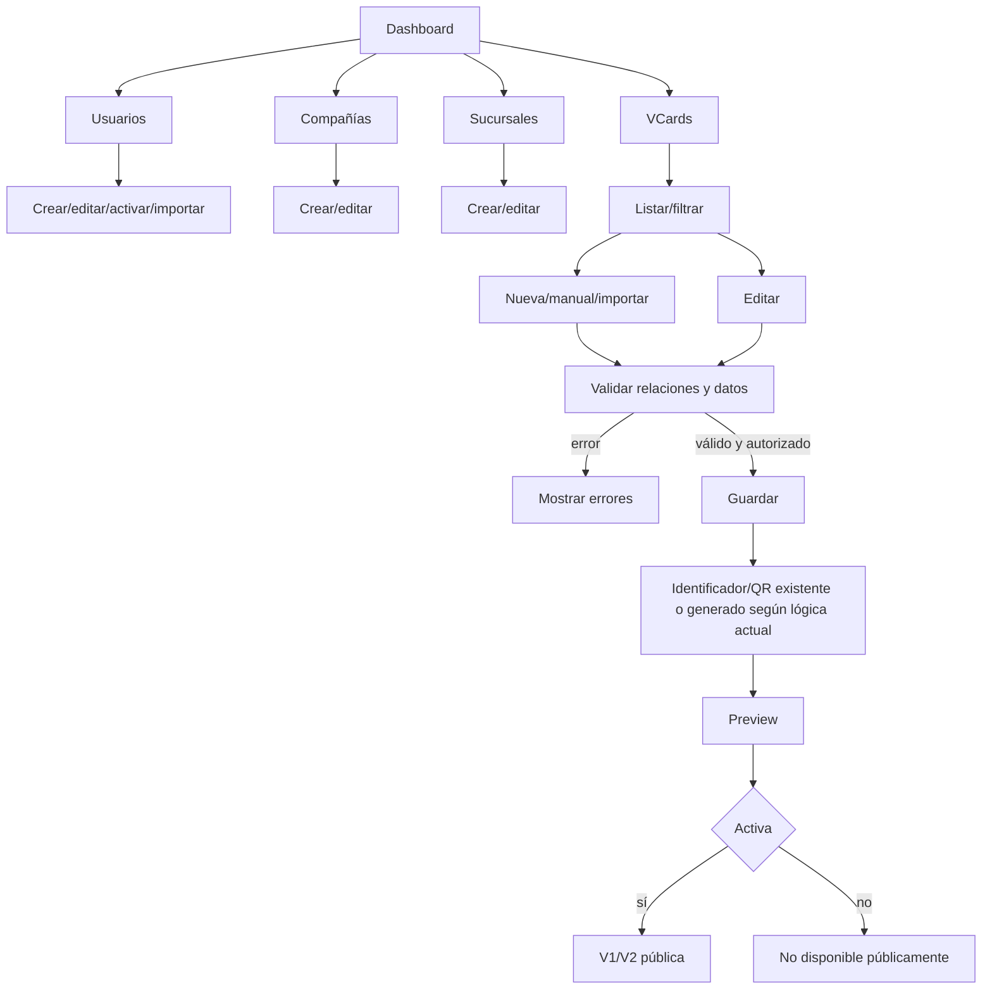

Esta rama no altera el CRUD ni la generación de QR; se documenta para regresión integral.

## Flujo 9 — Temas, banners y promociones

**Estado:** descriptivo del sistema actual; solo cambió la composición pública V2.

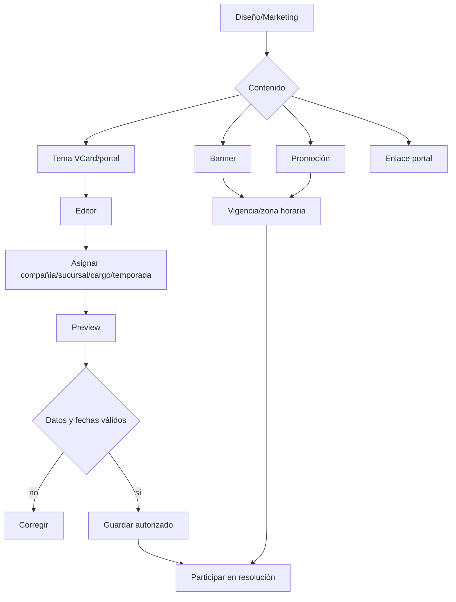

El preview no prueba el resultado público por sí solo; QA debe validar la ruta real o fixture protegida.

## Flujo 10 — Analítica, reportes y operación

**Estado:** descriptivo; la rama protege únicamente la lectura de escaneos relacionada con VCards.

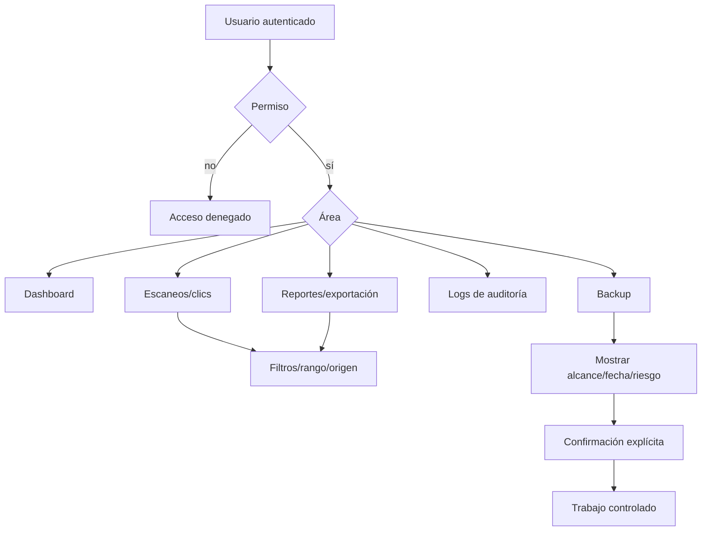

Backup y restauración son operaciones de alto riesgo. Esta fase solo respaldó fuente sanitizada; no operó PostgreSQL.

## Flujo 11 — Portal cautivo 9301

**Estado:** descriptivo y no validado funcionalmente en esta fase; no hubo cambios.

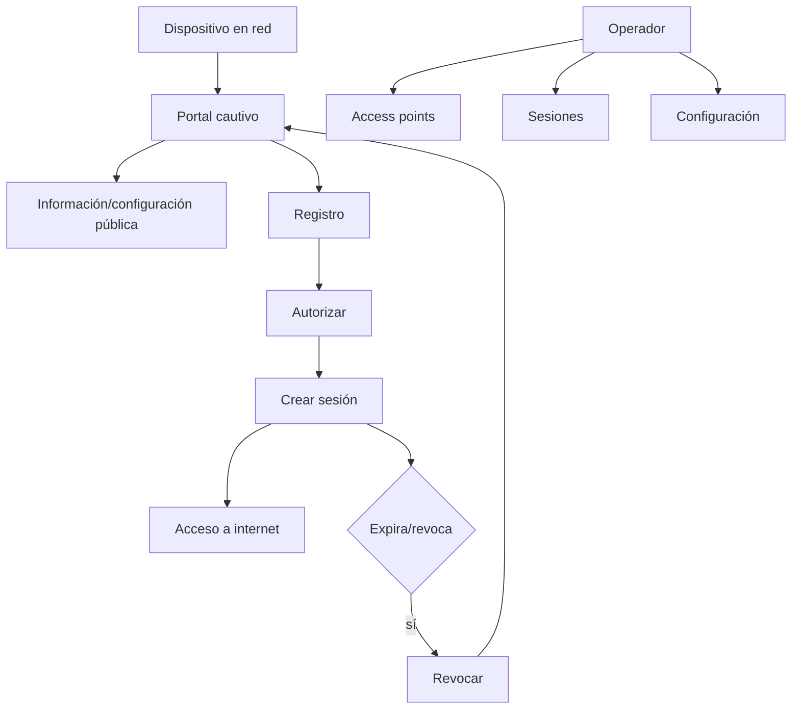

Este flujo es descriptivo. 9301 no se modificó, reinició ni validó destructivamente.

## Matriz de errores

| Caso | Superficie | Resultado esperado | Reintento |
|---|---|---|---|
| ID desconocido/inactivo | Pública | 404 neutral | No automático |
| Firma inválida | Pública | 403/estado neutral | Abrir enlace válido |
| BD/API caída | Pública/admin | 503 o error temporal | Sí, controlado |
| Dato de acción ausente | Pública | Ocultar control | No |
| URL insegura | Pública | Bloquear | Corregir configuración |
| Sin permiso | Admin | 403, no filtrar datos | Solicitar acceso |
| Sesión expirada | Admin | Login con retorno seguro | Sí |
| Validación de formulario | Admin | Errores por campo | Sí |
| Conflicto de agenda | CRM futuro | Refrescar cupos | Sí, idempotente |
| CRM caído | CRM futuro | No confirmar | Sí con backoff |
| Portal/AP no disponible | 9301 | Error operativo aislado | Según runbook |

## Navegación y rutas principales

| Área | Rutas representativas |
|---|---|
| Pública | `/vcard/[id]`, `/v2/vcard/[id]` |
| Acceso | `/login`, `/login/forgot-password`, `/login/reset-password` |
| Inicio/operación | `/dashboard`, `/reportes`, `/logs`, `/backup` |
| Organización | `/usuarios`, `/usuarios-admin`, `/ubicaciones`, `/vcards/companias`, `/vcards/sucursales` |
| VCards | `/vcards`, `/vcards/editor`, `/vcards/manual`, `/vcards/scans` |
| Diseño | `/temas`, `/vcards/temas`, `/vcards/theme-builder`, `/banners`, `/promociones`, `/links` |
| Portal | `/portal`, `/acceso`, `/internet`, `/configuracion/portales`, `/portales/sucursales` |

## Puertas de liberación

1. PR revisado y aprobado.
2. Build, tests, typecheck y lint satisfactorios.
3. Matriz visual 3×5 y accesibilidad revisadas.
4. V1 y QR sin regresión.
5. 9301 sin cambios y health check de solo lectura.
6. Sin migración ni escritura BD.
7. Backup y rollback verificados.
8. Autorización explícita de despliegue.
9. Cero riesgos P0 abiertos o aceptación formal con mitigación, responsable y fecha.
10. HTTPS/proxy, Marketing/Legal y UAT aprobados.
11. Definir backup requerido —fuente, build y, si aplica, BD—, checksum y prueba de restauración; el respaldo fuente no cubre PostgreSQL.

## Preguntas pendientes

- ¿Qué roles exactos acceden a cada módulo administrativo?
- ¿Cuál es el origen estable de marca: slug, compañía, sucursal o nuevo campo futuro?
- ¿Qué canal de agenda manual aprueba negocio?
- ¿Cuál es el contrato oficial del CRM y sus estados?
- ¿Qué métricas y retención autoriza la política de privacidad?
- ¿Se separarán portal cautivo y VCards en despliegues/BD distintos?
