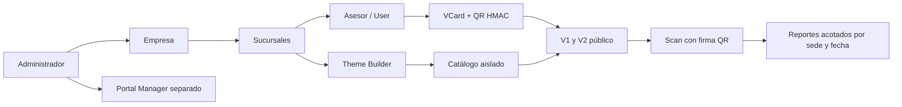

# Consolidación VCards V2 — PR #27 al #36

**Fecha de corte:** 2026-10-29. **Rama:** `consolidation/vcards-pr27-pr36-20261029`.
**Base de comparación:** `security/vcards-company-branch-directory-rbac-20261027` (PR #26).
**Objetivo:** una sola candidata para pruebas integradas, sin fusionar ni desplegar al servidor.

## Dependencias y alcance

| Orden | PR | Archivo técnico | Criterio |
|---:|---|---|---|
| 1 | #27 | PR27_SCAN_AGGREGATES.md | Filtros aplicados a byDate/byDevice |
| 2 | #28 | PR28_V1_SCAN_ID.md | V1 envía ID interno; QR histórico intacto |
| 3 | #29 | PR29_QR_KEY_ROTATION.md | Secret de firma separado, históricos verificables |
| 4 | #30 | PR30_SIGNED_SCANS.md | QR con firma válida; DIRECT se mantiene separado |
| 5 | #31 | PR31_BRANCH_THEME_TRANSACTIONS.md | Tema acorde a categoría/empresa; cambios atómicos |
| 6 | #32 | PR32_BRANCH_DELETE_INTEGRITY.md | DELETE Branch sin borrar datos relacionados |
| 7 | #33 | PR33_THEME_CLONE_SCOPE.md | Diseñadores no clonan otras marcas |
| 8 | #34 | PR34_CALENDAR_DATE_VALIDITY.md | Fechas calendáricas reales y límites Honduras |
| 9 | #35 | PR35_USER_PRIVILEGE_POLICY.md | Protección SUPER_ADMIN y autocambio de rol |
| 10 | #36 | PR36_THEME_CATALOG_RBAC.md | GET/PUT/DELETE y borradores aislados por compañía |

Los PR son apilados: #27 depende de #26; #28 de #27; así sucesivamente hasta #36. Este PR consolida **exactamente las mejoras del lote**, no sustituye la revisión de los PR originales ni incluye autorizaciones de producción.

## Arquitectura final de flujo



## Verificaciones automatizadas
- Revisar último SHA y resultado de GitHub Actions **de esta rama consolidada**, no solo de PR individuales.
- Pipeline: npm ci, Prisma validate/generate, TypeScript, tests unitarios, PostgreSQL 16 efímero, lint y build.
- `tests/consolidation-contracts.test.ts` prueba compatibilidad transversal de filtros locales, HMAC nuevo/legado, permisos de tema y fechas.
- Para trabajo local, `bash scripts/vcards-consolidation-preflight.sh` ejecuta únicamente verificaciones de código, nunca despliega ni escribe DB.
- No ejecutar `prisma db push` en servidor real: en CI opera contra un contenedor descartable `vcards_ci`.

## Matriz E2E pendiente para Codex
1. Empresas Ford Yude, GAC Yude, Quick Lane con SPS/TGU y sucursales homónimas: comparar vCards sin contaminación entre compañías.
2. Usuarios SUPER_ADMIN, ADMIN, IT, MARKETING y sin sucursal: probar GET/POST/PUT/DELETE de Companies/Branches/Theme y reportes; 401/403/404/409 correspondientes.
3. Theme Builder y catálogo: crear borrador, reabrir sin perder capas, clonar empresa propia/global, intentar marca ajena 403, editar tema publicado 409 y programar fechas.
4. QR públicos reales: escaneo V1/V2, firma correcta/incorrecta, descargable VCF, QR histórico, medición no duplicada y tarjeta archivada.
5. Escaneos a 23:59 y 00:00 Honduras: sumatorias porDate/byDevice, paginación y límites; comparar con SQL parametrizado sin datos privados.
6. Eliminar sucursal con usuario/Scan/AccessPoint debe responder 409 y preservar IDs e histórico.
7. Probar concurrencia real (alta de tarjeta vs archivado/borrado sucursal) y audit logs tras fallo de persistencia.
8. Pruebas visuales 360, 390, 768, 1024 y 1440 px; impresión doble cara CR80 y escaneo en smartphone.
9. Identificar reverse proxy 9301/9306, DB compartida, compatibilidad de `Theme.config.layout` y rutas `/vcard/[id]` y `/v2/vcard/[id]`.
10. Registrar snapshot del despliegue previo, backup cifrado fuera de repo, ensayo de restauración, rollback y aprobación de cambio.

## Deuda técnica y límites explícitos
- No hay pruebas de navegador/impresora real ni carga con usuarios concurrentes; CI no equivale a estabilidad de producción.
- `Scan` conserva IP y User-Agent; revisar minimización/retención, confianza en proxy y rate limit. DIRECT/MANUAL pueden ser falsificados si no se añaden mecanismos adicionales.
- Borradores históricos `Theme.companyId = null` no se adjudican automáticamente. Crear mapeo aprobado antes de darles propiedad.
- ThemePublication/ThemeVersion por sede no se ha implementado; fechas están en Theme y podrían ser compartidas por destinos si se reutiliza el mismo ID.
- La clave `VCARD_SIGNING_SECRET` exige plan de rotación e inventario de QR antes de sustituir secretos heredados.
- Protección de borrado de Branch conserva dependencias conocidas, pero hay que auditar otras rutas SQL de administración.
- Probar cadena de permisos con operaciones reales y sesgos de timing en la base. Auditoría no garantiza entrega transaccional sin patrón outbox.

## Procedimiento de Codex
```bash
git fetch origin
git checkout consolidation/vcards-pr27-pr36-20261029
git rev-parse HEAD
npm ci
npx prisma validate
npx prisma generate
bash scripts/vcards-consolidation-preflight.sh
```

La ejecución previa es local/staging **sin credenciales productivas**. Si cualquier check falla, corregir en rama de integración, adjuntar evidencia de SHA y volver a ejecutar todos los controles. No modificar 9301/9306 ni base productiva sin aprobación explícita.

## Rollback
No se ha modificado producción. La consolidación se puede descartar como rama; los 10 PR originales permanecen. Tras un eventual despliegue aprobado, usar release anterior con checksum y copia DB ensayada. Revertir código no revierte cambios de datos generados mientras una versión estuvo activa.
