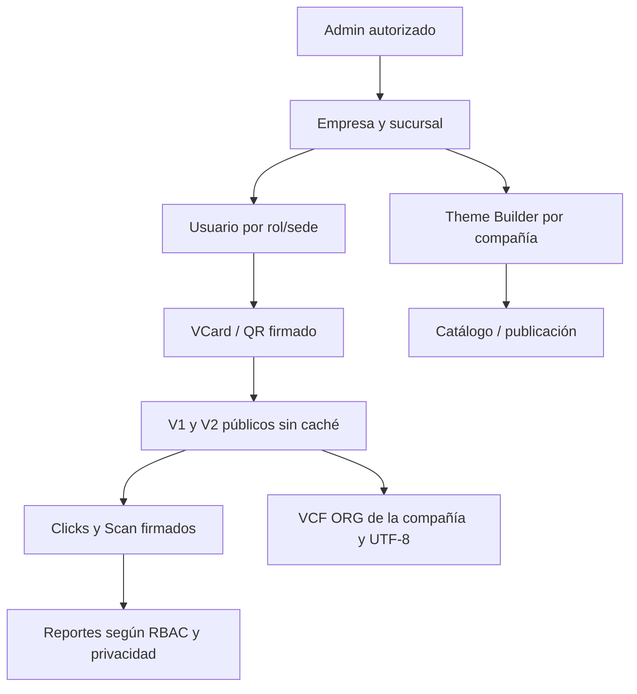

# Consolidación de VCards V2 — PR #38 al #47

**Fecha:** 2026-10-29. **Rama acumulativa:** `consolidation/vcards-pr38-pr47-20261029`.
**Base técnica:** `consolidation/vcards-pr27-pr36-20261029` (#37).
**Política de release:** ningún merge automático, ninguna migración ni conexión a 9301/9306.

## Cambios entregados

| PR | Mejoras | Riesgo que reduce |
|---|---|---|
| #38 | Clicks con acción estricta, HMAC configurable y tarjeta activa | métricas falsas e inactivas |
| #39 | GET Users con RBAC, sede y campos explícitos | enumeración de usuarios entre empresas |
| #40 | POST Users con validación de rol y contraseñas seguras | elevación de privilegios y contraseñas débiles |
| #41 | VCF ORG por razón social, no nombre sucursal ni Ford fijo | contactos mal identificados en GAC/Quick Lane |
| #42 | VCF CRLF y pliegue UTF-8 75 octetos | importación incorrecta en móviles |
| #43 | V1/V2 SSR dinámico y JSON de perfil no-store | exposición por caché/indexación |
| #44 | Reportes sin IP/User-Agent para no-admin | exposición de datos de visitantes |
| #45 | POST Branch verifica ThemeCategory y CompanyId | mezcla de PORTAL/VCARD entre marcas |
| #46 | POST/PUT Theme valida enum ThemeType | errores persistencia y payload inválido |
| #47 | Auditoría sin almacenar firma QR enviada ni IP en texto de log | divulgación de secretos/tokens |

## Arquitectura de flujo



## Orden de integración
Los PR son apilados por HEAD sobre BASE #37 → #38 → #39 → #40 → #41 → #42 → #43 → #44 → #45 → #46 → #47. El PR de consolidación solo da una vista conjunta para **Codex**; no reemplaza revisión de PRs individuales. Cuando una rama más antigua falle por dependencias, probar el SHA final de la consolidación y comparar diferencias.

## Pruebas automatizadas
1. `npm ci`, `npx prisma validate`, `npx prisma generate`, `npm run typecheck`, `npm test`, `npm run lint`, `npm run build`.
2. GitHub Actions también arranca PostgreSQL desechable `vcards_ci` y ejecuta pruebas de integración dentro del job; **no copiar prisma db push al servidor de producción**.
3. `tests/consolidation-pr38-pr47.test.ts` verifica permisos, tipos, clicks, serialización CRLF/UTF-8, brand ORG, privacidad y auditoría sin firma.
4. CI verde prueba código en laboratorio, no funcionamiento real de dominios, navegador, reverse proxy ni impresora.

## Plan de verificación E2E necesario en staging
- Sesión MARKETING de SPS: `GET /api/users?kind=all` devuelve 403, `kind=vcard` solo SPS; ADMIN ve lo autorizado sin password/reset/2FA.
- Usuario de otro branch no puede crear nuevas cuentas ni escalar a ADMIN/IT/SUPER_ADMIN; contraseña generada queda inutilizable hasta reset autorizado.
- Móviles Android/iOS y Thunderbird importan VCF Ford/GAC/Quick Lane; ORG representa compañía y acentos/emoji sobreviven a pliegue.
- V1 y V2 renderizan vCard activa y firmada; tras archivado ya no muestran el contacto. Validar caché real con Traefik/CDN, no solo cabeceras.
- Registrar clics reales (tel/email/wa) con firma, 400 acción inválida, 404 tarjeta archivada, 403 firma alterada si firma obligatoria.
- GET métricas a MARKETING oculta IP y User-Agent, IT autorizado los ve. Garantizar aislamiento de sedes.
- POST Branch rechaza ThemeCategory de otra función y marca; POST/PUT temas rechaza valores fuera enum; Theme Builder conserva layout.
- Firma inválida genera evento mínimo sin almacenar HMAC enviado, nombres ni IP en logs de aplicación; AuditLog mantiene campo IP estructurado bajo retención.
- Comparar la versión previa de 9301 y el runtime 9306, rutas proxy y `Theme.config`, sin editar el servicio original.
- Pruebas a 390, 768, 1024, 1440px, QR impreso y tarjeta CR80 anverso/reverso, además de pruebas de recuperación de respaldo.

## Deuda técnica y riesgo residual
- Los click events podrían falsificarse mientras `REQUIRE_VCARD_SIGNATURE=false`; hay que inventariar QR legacy para cerrar completamente la vía.
- User create no implementa invitación/reset automático; una contraseña aleatoria no entregada exige flujo de activación aprobado.
- Los datos históricos de Scan y AuditLog siguen reteniendo IP: política de purga/anonimización depende de decisiones corporativas.
- Las restricciones de unicidad de Company/Branch aún requieren migración versionada previa auditoría histórica; CI aislado no autoriza SQL en producción.
- Las validaciones de backend de Theme Builder no eliminan necesidad de revisión de UX/ impresión física / APIs antiguas.
- No se hicieron pruebas manuales en el servidor ni aplicaciones conectadas, y este paquete no incluye autorización de instalación.

## Comandos para Codex

```bash
git fetch origin
git checkout consolidation/vcards-pr38-pr47-20261029
git rev-parse HEAD
npm ci
npx prisma validate
npx prisma generate
npm run typecheck
npm test
npm run lint
npm run build
```

Para inspección del host Debian autorizado: `bash scripts/vcards-release-preflight.sh` (solo lectura). Preparar release inmutable, backup cifrado, restore ensayado y rollback por SHA **antes** de solicitar permiso de despliegue. Mantener puertos 9301 y 9306 sin cambios hasta que staging pase QA.

## Rollback
Deshacer la rama de consolidación no modifica producción. En eventual rollout aprobado, rollback por release con datos comparados por ID, QR y Scan; rollback de código **no revierte** operaciones de usuarios posteriores.
