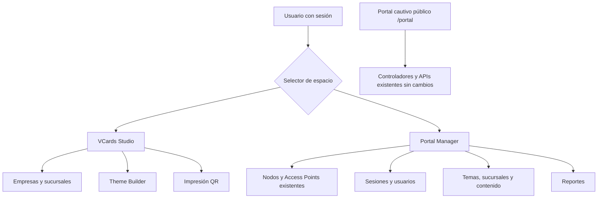

# PR-07A — Separación inicial del Portal Manager

**Alcance**: navegación independiente dentro de la misma aplicación Next.js. Ningún puerto, servicio, API, esquema Prisma o controlador de red se cambia.

## Motivación
Antes, el mismo sidebar mostraba el editor de tarjetas vCard y la configuración de portales cautivos. La identidad fija `Ford Admin / Portal Cautivo` resultaba inconsistente en áreas Ford/GAC/Quick Lane.

## Cambios
- `/portal-admin` es el nuevo punto de entrada para administradores de portales, con accesos a nodos/AP, sesiones, temas, sucursales, enlaces y reportes.
- El sidebar permite alternar explícitamente entre **VCards Studio** y **Portal Manager**. Cada espacio muestra su grupo de navegación específico, conservando el grupo Sistema.
- `/usuarios`, `/ubicaciones`, `/temas-portal`, `/links`, `/promociones`, `/portales/sucursales` mantienen URL y lógica existentes; no se reescriben los drivers.
- Se define `isPortalWorkspacePath` y pruebas unitarias para impedir mezclar rutas públicas `/portal`, `/vcard/:id`, `/vcards`.

## APP FLOW

## QA obligatoria
- `npm ci`, `npm run typecheck`, `npm test`, `npm run lint`, `npm run build`.
- Navegar entre espacios desde dashboard, /vcards, /portal-admin, /usuarios y /ubicaciones; comprobar sidebar coherente al refrescar.
- Confirmar que `/portal` público no recibe interfaz administrativa ni rutas nuevas, y que 9301 queda intacto.
- Revisar roles: entrar a páginas y acciones administrativas solo cuando API/route y sesión permitan. El nuevo landing exige sesión pero no sustituye verificaciones de autorización de cada API.
- Revisar reportes en `/reportes?tab=portal`: al usar ruta compartida podría mostrarse el sidebar vCards. Queda anotado como trabajo posterior, no declarar aislamiento completo.
- Probar a 360, 390, 768, 1024 y 1440 px; accesibilidad teclado y navegación.
- Mantener accesos de las marcas Ford/GAC/Quick Lane sin imponer branding fijo del portal en vCards.

## Futuro: PR-07B/08 Gestión de nodos
- Normalizar inventario de AP por `AccessPoint.branchId`, estado/reconciliación de nodos, adaptadores documentados (CUDY/manual ya presentes; otros solo tras verificación real).
- Separar secretos (RADIUS/NAS/Wi-Fi) de respuestas públicas, vault/env/RBAC, rotación y auditoría.
- Incorporar descubrimiento, salud/conectividad, reintentos y pruebas de integración con simuladores antes de probar en equipos físicos.
- Evitar cambios en portal de invitados sin ensayo de continuidad, ventanas de mantenimiento y rollback.

## Operaciones y reversión
No se despliega desde esta conversación. Si se integra por error, revertir solo los commits de UI y nuevo route; no hay migración ni cambio de configuración. Comprobar rutas legacy desde marcadores. Mantener backup de release, no alterar puertos 9301/9306.
