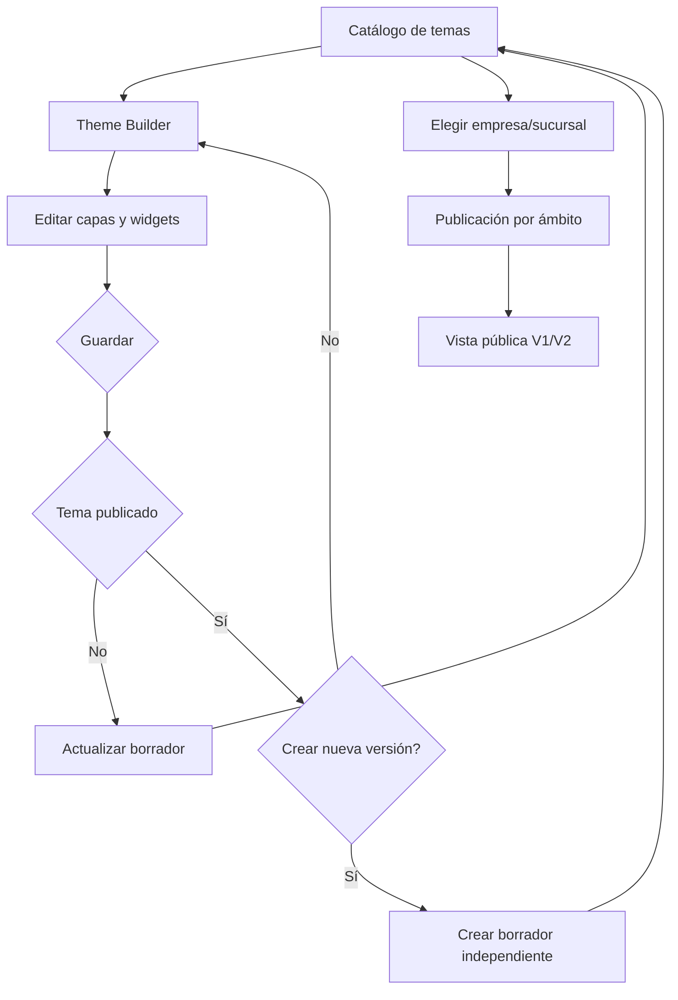

# PR-07 — Theme Builder único, borradores seguros y edición sin pérdida

Fecha: 2026-10-26. **Stacked PR** basado en `feat/vcard-themes-scoped-publishing-20261026` (#3, que depende de #2). No tocar 9301/9306 o PostgreSQL.

## Diagnóstico de código
- `Theme Builder` convertía sus elementos a bloques runtime `config: []` al guardar y, al editar, intentaba reconstruirlos, perdiendo coordenadas, fuentes, transformaciones, agrupaciones y parámetros no reversibles.
- El botón Snap mutaba `doc.canvas.snap` fuera de `setDoc` y lo calculaba desde `showGrid`, causando inconsistencias.
- El QR de vista previa remitía a `/vcards/theme-builder` (requiere administración, no a la vCard pública). Retirarlo evita imprimir o distribuir enlaces que no sirven al cliente.
- El guardado consideraba éxito un JSON con propiedades `theme` aunque la respuesta fuese error.
- Dos entradas "Theme Builder" y "Editor Temas" parecían dos editores; se clarifican como **Diseñar temas** y **Publicar temas**.

## Implementación / contrato
- Nuevo `lib/vcard-theme-format.ts` soporta tanto `Theme.config = RuntimeBlock[]` (legacy) como `Theme.config = {layout: RuntimeBlock[], studioDoc: StudioDocument}`.
- La página pública V1/V2 ya acepta `config.layout`. La vista previa del catálogo ahora llama `themeRuntimeLayout`.
- POST/PUT `/api/vcard-themes`: acepta `studioDoc` opcional, conserva contrato legacy sin él, valida arrays, y limita documento a 2 MB.
- El Theme Builder guarda la representación *exacta* con coordenadas/capas/media y abre el documento preservado. Para temas antiguos sin `studioDoc`, usa el importador legacy no reversible existente.
- PUT de diseño rechaza con **409 THEME_PUBLISHED** cuando está activo o está referenciado en Company, Branch o reglas por puesto; el Builder propone guardar nueva copia como borrador y requiere confirmación.
- El catálogo sirve para listar, clonar, editar **abriendo el único diseñador**, programar y publicar según destino. No tiene editor de lienzo propio.
- La vista previa usa datos de demostración; ningún QR de ejemplo abre incorrectamente la administración.

## App Flow

## QA requerida antes del merge
1. `npm ci; npx prisma validate; npx prisma generate; npm run typecheck; npm test; npm run lint; npm run build`.
2. Crear tema con bloques personalizados (x/y, rotación, medios, visibilidad, sombra, agrupaciones), guardar, cerrar, reabrir: comparación JSON `studioDoc` exacta, sin pérdida de capas.
3. Para temas antiguos `config: []`, abrir sin error y guardar nuevo borrador; verificar que V1/V2 dibujan tanto arrays legacy como objetos `{layout,studioDoc}`.
4. En una BD aislada, publicar Ford en una empresa y Quick Lane en otra; editar Ford publicado, recibir 409, ofrecer creación de borrador, mantener intacta la vCard anterior.
5. Simular error 4xx/5xx al guardar: mostrar error, mantener modal/datos, no falsificar éxito.
6. Probar controles Snap/Grid separados; no mutar estado directamente. Abrir catálogo desde botón Publicar temas, conservar navegación vCards.
7. Crear vCard y escanear QR **original de vCard**, no QR de editor; probar V1, V2, firmas HMAC, no regresión de métricas.
8. Seguridad: tamaño máximo, permiso por rol, no desplegar código arbitrario HTML sin la revisión de seguridad del renderer.
9. Responsive 360/390/768/1024/1440 y modo teclado.

## Limitaciones
No incluye nuevo servidor de previews públicos, programación independiente por sucursal (`ThemePublication`), control de versiones DB inmutable, ni migración de JSON histórico. Temas guardados previamente sin `studioDoc` solo pueden importarse aproximadamente una vez. Se requiere QA de integración real antes de considerarlo apto para producción.

## Rollback
El contenido legacy no migra. El formato objeto es compatible con clientes públicos actuales V1/V2 del repo pero **antes de desplegar** confirmar que los servicios 9301 y 9306 no compartan código/BD incompatibles. Si versión 9301 no entiende `config.layout`, habilitar upgrade coordinado o impedir persistir objeto hasta separar DB; no hacer rollout prematuro. Revertir commit por release completo y conservar backup de filas de temas.
