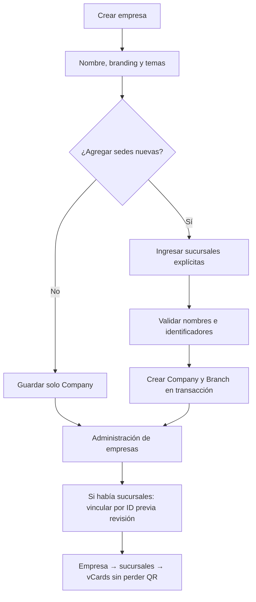

# PR-08 — Crear empresas sin sucursales fantasma

**Fecha:** 26 de octubre de 2026. Basado en PR #2. Sin cambios automáticos de producción o de PostgreSQL.

## Hallazgo reproducible por inspección
`POST /api/companies` creaba siempre una Branch implícita cuyo `name` era igual al nombre de Company, y luego insertaba las sedes introducidas manualmente. El asistente visual además precargaba Tegucigalpa. Por eso cada razón social podía aparecer como sede o generar duplicados, aunque ya existieran sucursales en BD sin relación asignada.

## Nuevo contrato
- `POST /api/companies` **nunca** crea automáticamente una sucursal con el nombre de la empresa.
- `branches: []` o ausencia del campo crea solo la compañía; si envía `branches:[{city,...}]` se crean exclusivamente las sedes explícitas.
- La forma inicia con cero sucursales y el texto informa al administrador que también puede vincular las existentes por ID desde la gestión de compañías (PR #2).
- Se comprueba nombre de empresa previamente existente sin distinguir mayúsculas/minúsculas; en conflicto se responde 409.
- El orden de las sucursales nuevas comienza en 0 porque ya no hay una rama principal artificial. No se cambia ninguna sede previamente registrada, ni QR, usuario o escaneo.
- Validación de identificadores de sucursal duplicados devuelve 422; la creación de Company y las sedes explícitas permanece transaccional.
- Pruebas `tests/company-onboarding.test.ts` documentan compañía sin sucursales, múltiples sedes explícitas y rechazo de duplicadas.

## App Flow

## QA requerido
1. `npm ci; npx prisma validate; npx prisma generate; npm run typecheck; npm test; npm run lint; npm run build`.
2. En DB aislada crear nueva empresa SIN sedes: `Company` existe, `Branch` 0; no se crea sucursal `name = Company.name`.
3. Crear empresa con SPS/TGU/CBA explícitas: exactamente 3 `Branch` con misma `companyId`, `sortOrder` secuencial 0..2, nombres no duplicados.
4. Validar nombres con mayúsculas/minúsculas diferentes y slugs repetidos: 409, sin insertos parciales.
5. Cargar una sucursal huérfana heredada: crear empresa sin sedes y vincular por ID desde PR #2, sin cambiar `VCard.id`, `qrCodeData` o `qrImageUrl`.
6. Crear/editar vCard empresa→sucursal con PR #2 y comprobar en V1, V2, QR, reportes y permisos.
7. Probar errores de red, formularios responsivos 390/768/1440 y roles.
8. Auditoría de datos viejos (solo lectura): la corrección previene nuevas duplicaciones pero NO elimina ni fusiona empresas/sedes ya duplicadas.

## Restricciones y rollback
No ejecutar deduplicación por nombre, `DELETE`, SQL `UPDATE` masivos ni regenerar QR para "reparar" información. Aprobación y backup con restauración antes de vincular registros históricos. Merge después de PR #2, comprobar PR #3 y #7 apilados sin conflictos. Rollback con commit/release completo anterior; toda entidad nueva creada por administrador permanece y requiere tratamiento de datos separado.
