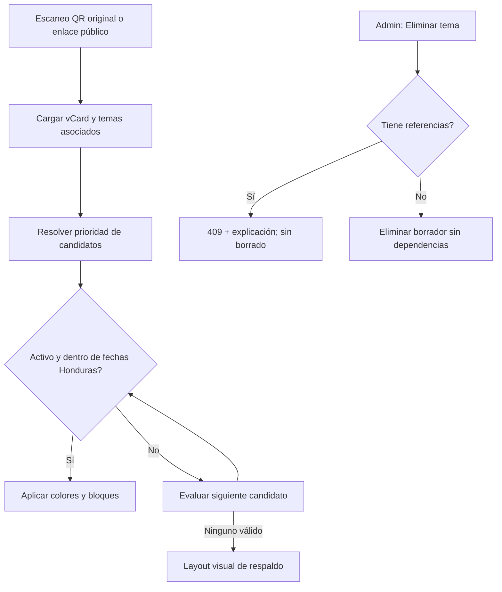

# PR-09 — Resolución segura de temas públicos y eliminación protegida

Fecha: 2026-10-26. **PR apilado sobre #7**, que depende de #3 y #2. No contiene migración ni hace cambios directos a PostgreSQL o los servidores 9301/9306.

## Diagnóstico de los defectos
1. En V1 y V2, el selector público asignaba `branch.vcardTheme` aunque estuviera desactivado; como la variable era no nula, bloqueaba un tema corporativo o global perfectamente válido. Más tarde se comprobaba `isActive` para los colores, pero **se usaba igual `config` del tema desactivado**. Esto podía mostrar un diseño distinto del previsto.
2. Solo se aplicaba el calendario a `branchSeasonalTheme` y `companySeasonalTheme`. Las reglas de cargo, temas base, global y legacy podían continuar activos después de `validTo` o antes de `validFrom`.
3. V1 y V2 duplicaban reglas de prioridad: las futuras mejoras a una pantalla podían desincronizar el resultado.
4. `DELETE /api/vcard-themes?id=...` borraba un tema directamente y dependía de errores de FK de PostgreSQL, sin explicar el problema. La interfaz no comprobaba `response.ok` y parecía haberlo eliminado aunque el servidor devolviera error.

## Implementación
- `lib/vcard-theme-resolver.ts` define un único algoritmo para **ambas vistas públicas**:
  1. tema por grupo de puesto (si la regla está habilitada)
  2. tema estacional de sucursal
  3. tema base de sucursal
  4. tema estacional corporativo
  5. tema base corporativo
  6. tema global de respaldo
  7. tema legacy de sucursal
- Un candidato solo participa si `isActive===true` y pasa la ventana `validFrom/validTo` de `America/Tegucigalpa`, con extremos inclusivos. Si ninguno pasa, se usa la tarjeta visual de respaldo existente sin tema publicado.
- Las rutas públicas preservan los mismos IDs, QR firmados, campos de User/Branch, URL, componentes de renderizado y métricas. No se modifica firma, secreto, roles, estructura de BD ni política de enlaces V1/V2.
- `DELETE` consulta referencias antes de borrar en una transacción serializable. Rechaza 409 si existen referencias en Company (`defaultVcardThemeId`, `seasonalVcardThemeId`), Branch (portal/base/estacional/legacy), VCardPositionThemeRule (incluso deshabilitadas), o AccessPoint (portal cautivo).
- Sólo se puede borrar un tema `category='VCARD'` sin referencias; 404 si no existe, 401/403 si no hay permiso, 409 para cambios concurrentes/FK. El catálogo muestra error real y no simula éxito.
- `tests/vcard-theme-resolver.test.ts` y `tests/vcard-theme-deletion.test.ts` cubren prioridad, fechas, desactivación y referencias.

## App Flow (Mermaid)

## QA requerida antes de fusionar
1. `npm ci && npx prisma validate && npx prisma generate && npm run typecheck && npm test && npm run lint && npm run build` sobre SHA final.
2. En DB staging con Ford, GAC y Quick Lane: asignar tema desactivado a sucursal y uno corporativo activo. En V1/V2 debe prevalecer corporativo.
3. Reglas de puesto activas vs desactivadas; intervalo pasado/futuro, límites de fecha y transición a medianoche Honduras.
4. Verificar que tema global no sustituya a empresa correctamente publicada; que legado funciona si todos los ámbitos superiores no son válidos.
5. Confirmar QR anterior permanece válido, sin regeneración, y que el comportamiento de tracking V1/V2 no se altera.
6. DELETE de tema libre: 200; vinculado en empresa, sucursal, puesto deshabilitado o AccessPoint: 409 y registro intacto; categorías no VCARD: 404; permisos: 401/403.
7. Simular carrera entre asignación de tema y DELETE. El FK debe evitar referencias huérfanas aun cuando la comprobación de conteo sea anterior al cambio.
8. UI 390/768/1440, error de catálogo visible en pantalla y no falsos éxitos.
9. **Verificar compatibilidad con el servicio 9301 y su código real**, sobre todo si lee la misma BD o un cache de tema. No desplegar sin este gate.

## Restricciones y rollback
No hay operaciones de datos ejecutadas ni migraciones. No se autorizó deploy. Si hubiera regresión, `git revert` del PR y redeploy del release 9306 anterior desde backup; el componente público V1 y V2 debe compararse con capturas y QR de referencia. El mismo `Theme.isActive` sigue siendo una señal global de disponibilidad: un esquema futuro de publicación versionada por destino aún requiere PR distinto (`ThemePublication/ThemeVersion`).
