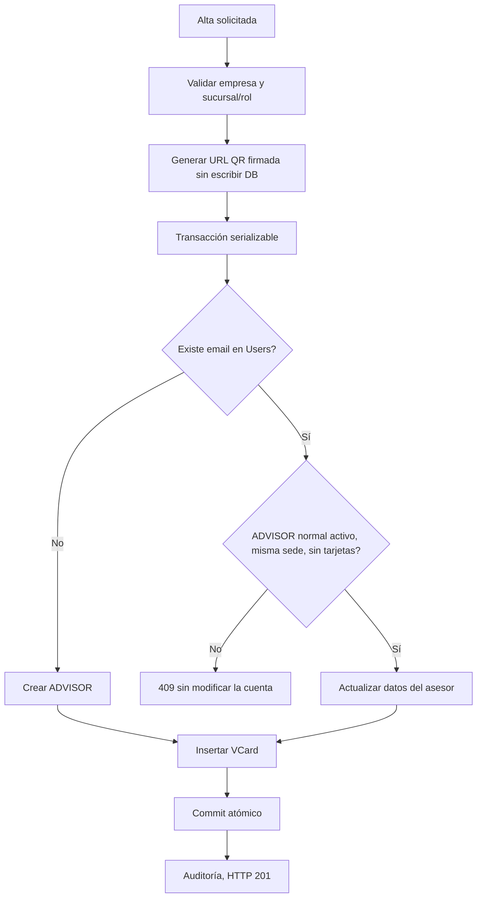

# PR-11 — Alta de vCard atómica y protección de cuentas existentes

Fecha 2026-10-26. PR basado en la rama de integración #10. Sin cambios de BD ni despliegue.

## Hallazgo confirmado
`POST /api/vcards` buscaba al usuario por email, actualizaba su nombre, teléfono y `branchId`, y **después** verificaba si ya tenía una vCard en la sucursal. Esto podía alterar una cuenta aun cuando la operación fallara por duplicado. También podía modificar cuentas administrativas o de sistema con el mismo email que se introdujera en un formulario.

## Solución
- `lib/vcard-account-integrity.ts` define reglas puras y probadas: solo reutilizar cuentas ADVISOR que no sean de sistema, estén activas, estén en la misma sede (o sin sede/ninguna tarjeta), y carezcan de vCards previas. Cuentas en otras sedes o con tarjetas reciben 409 y no se modifica ningún campo.
- QR HMAC e imagen PNG se preparan **antes** del bloque de escritura; si falla la generación no se crea usuario.
- `User` y `VCard` se crean/actualizan juntos en transacción Prisma con aislamiento serializable, tras verificar conflictos de cuenta y tarjetas **dentro** de la transacción. Un conflicto P2002/P2034 devuelve 409.
- No se cambia la cadena HMAC, URL, secreto, ID de vCards existentes ni se migran registros.
- La grabación de auditoría sigue después del commit: en caso de fallo se registra error de servidor, pero se devuelve 201 porque la tarjeta ya existe; no se debe inducir a repetir operaciones exitosas mediante falsos HTTP 500.
- Pruebas unitarias `tests/vcard-account-integrity.test.ts`: cuenta nueva, ADVISOR mismo branch, sistema/admin, inactiva, tarjeta duplicada, traslado de sede y tarjetas previas en otra sucursal.

## App Flow

## Pruebas de aceptación exigidas
1. `npm ci && npx prisma validate && npx prisma generate && npm run typecheck && npm test && npm run lint && npm run build` sobre commit final.
2. Crear vCard nueva para email inexistente; verificar **una** User y **una** VCard, mismo `branchId`, QR HMAC firmado y escaneable.
3. Usuario ADVISOR ya existente en misma sede sin vCard: se puede crear; fallo de QR no cambia User ni crea VCard.
4. Email administrador/sistema o desactivado: HTTP 409, cuenta/contraseña/rol/isActive/branchId sin cambios.
5. Usuario con vCard existente en la misma sede: 409 sin mutaciones previas. Usuario o vCard en otra sede: 409 sin trasladar ni reescribir User.
6. Concurrencia: dos POST del mismo email/sede a la vez; verificar que solo uno crea tarjeta. Si se producen conflictos serializables ambos errores HTTP deben corresponder a BD sin escrituras parciales.
7. Falla deliberada de `createAuditLog`: la tarjeta permanece, respuesta HTTP 201 y alerta de log de servidor, sin retry implícito.
8. Probar permisos MARKETING, IT y cuentas con sede restringida. Verificar QR existentes, stats, V1 y V2.
9. No divulgar email, contraseñas, firma HMAC ni `.env` en logs de CI.

## Limitaciones
- `VCard` no tiene `@@unique([userId, branchId])` en el Prisma schema actual. La transacción serializable reduce colisiones, pero Codex debe evaluar un constraint formal en futura migración **solo después de auditar duplicados históricos**, sin ejecutar `db push` en producción.
- Falta un proceso administrativo de traslado de usuario/cuenta entre sedes; 409 obliga a gestionarlo explícitamente.
- URL absoluta generada por `resolvePublicBaseUrl` usa parámetros de cabecera como fallback si la configuración de dominio falta. Requiere endurecimiento separado para prevenir Host header injection; no declararlo resuelto.
- La auditoría se realiza fuera de la transacción. Se debe crear prueba E2E de observabilidad y quizá patrón outbox de auditoría en proyecto posterior.
- No se han ejecutado pruebas contra el servidor ni BD de producción.

## Rollback
Revertir PR #11 completo o retornar a release anterior en staging. No restaurar datos de usuario sin backup comprobado. La transacción no cambia estructura ni historiales existentes; los cambios efectuados por usuarios tras un eventual despliegue deben gestionarse de forma separada.
