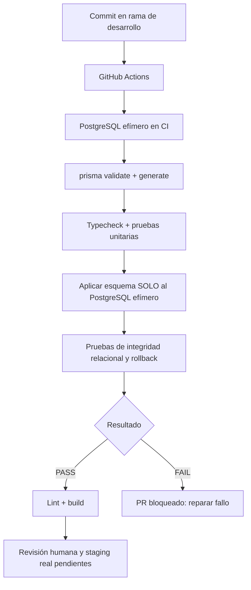

# PR-13 — PostgreSQL real en CI para contratos críticos de VCards

**Fecha:** 26 octubre 2026. PR apilado sobre #12 → #11 → #10. No altera PostgreSQL de producción.

## Qué se agrega
- El workflow GitHub Actions inicia PostgreSQL **16-alpine** en un contenedor efímero, con base `vcards_ci` accesible únicamente en 127.0.0.1:5432 desde el job.
- Tras validación/generación Prisma y las pruebas unitarias, ejecuta `npx prisma db push --skip-generate` **solo dentro de este job temporal** y luego `npx tsx --test tests/db-contract.integration.test.ts`.
- El test exige `CI=true`, `RUN_DB_INTEGRATION=true`, hostname 127.0.0.1, puerto 5432 y BD /vcards_ci. De lo contrario se niega a crear cualquier fixture.
- Comprueba sobre Postgres real: empresa sin sucursal implícita, sucursal creada explícitamente, usuario + tarjeta enlazados, transacción Prisma serializable que hace rollback completo ante error, FK de `Theme` contra `Company.defaultVcardThemeId` y limpieza de fixtures.
- Se mantienen typecheck, tests unitarios, lint y build; la prueba DB añade cobertura, no sustituye las otras.

## Política de seguridad
Estas credenciales PostgreSQL son temporales de CI, **NO** son ni pueden ser las de la IP productiva. El repositorio no se conecta con la BD activa en ningún momento. No copiar `prisma db push` a un manual de despliegue en producción: allí exige migraciones controladas, respaldo y ensayo de recuperación.

## App Flow

## QA no cubierta
- No levanta el servidor Next ni reproduce autenticación/RBAC, Service Layer, servicio 9301 o 9306 real. Tampoco realiza capturas browser, escaneo físico, ni reproducciones históricas con la BD existente.
- No prueba concurrencia real simultánea de POST HTTP ni contratos de APIs bajo NextAuth. Requiere test E2E de staging con datos anonimizados.
- `prisma db push` aquí es apropiado únicamente por ser una base **desechable vacía**. La compatibilidad del esquema productivo y la ausencia de migraciones históricas continúan pendientes.

## Criterio de aceptación
Se debe observar una ejecución de GitHub Actions sobre el **último SHA** de esta rama con: Prisma validate/generate PASS, Unit PASS, PostgreSQL integration PASS, lint PASS, build PASS.

## Rollback
Es infraestructura temporal de pruebas; descartar branch o revertir CI/test. No existe cambio persistente de esquema ni registros reales.
