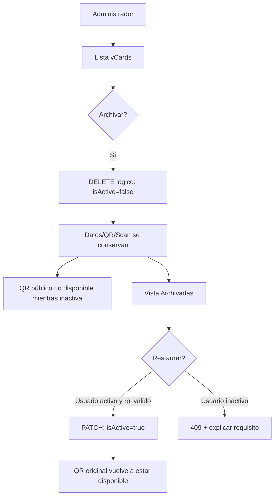

# PR-14 — Archivado reversible de vCards sin perder QR, escaneos ni métricas

Fecha: 2026-10-27. Basado en PR #13 → #12 → #11 → #10. Ningún cambio en producción ni migración Prisma.

## Diagnóstico comprobado
- `DELETE /api/vcards/:id` eliminaba definitivamente VCard si no había scans; con `?force=1` permitía eliminar aunque existieran escaneos.
- Según `prisma/schema.prisma`, `Scan.vcard` usa `onDelete: Cascade`: un borrado forzado **elimina todas las filas de Scan**, destruyendo métricas históricas de asesor y QR.
- La UI sugería forzar el borrado y no ofrecía restauración. Los grupos de tarjetas se generaban por nombre de sucursal, mezclando sedes homónimas de compañías distintas.
- `isActive` ya existe en VCard: no se necesita migración de esquema para archivar sin eliminar datos.

## Cambios implementados
1. `DELETE /api/vcards/:id` ahora es **archivar** (actualiza `isActive=false`); ignora `force=1`: no hay camino de destrucción desde esta ruta. Mantiene `VCard.id`, `qrCodeData`, `qrImageUrl`, `downloadCount`, User, Branch y Scan. Es idempotente (archivada → estado ya archivado).
2. Nuevo `PATCH /api/vcards/:id` restaura el registro original (`isActive=true`) con permisos ADMIN/IT/SUPER_ADMIN. Rechaza restaurar cuando el usuario dueño está inactivo, impidiendo publicar información de cuentas deshabilitadas.
3. UI `/vcards`: pestañas **Activas/Archivadas** con contadores, acciones *Archivar* y *Restaurar* con confirmación, QR y edición deshabilitados en las archivadas, sin sugerencia destructiva de force delete.
4. Listado agrupado por `Branch.id`, no por nombre, evitando mezclar sucursales homónimas.
5. Se conserva el contrato de permisos de DELETE; ningún rol de marketing o de otra sede adquiere capacidad de archivar o restaurar.
6. Prueba real PostgreSQL en `tests/db-contract.integration.test.ts`: crea tarjeta y escaneo de CI, archiva y restaura, comprueba ID QR y fila Scan idénticos y métricas intactas.

## App Flow

## QA de aceptación
1. `npm ci`, Prisma validate/generate, Typecheck, Unit, PostgreSQL Integration, Lint, Build exitosos sobre SHA final.
2. Crear vCard y 3 escaneos en DB **aislada**. Archivarla, comprobar que permanece en BD, que `Scan.count` no cambia y `qrCodeData` es igual. Restaurarla y verificar QR histórico idéntico.
3. Después de archivar, V1, V2, API público y descarga VCF deben rechazar usuario/ tarjeta inactivos; al restaurar, volver a funcionar con firmas válidas. **Nota:** V1 requiere PR #15 de seguridad para aplicar esta política en el SSR.
4. Repetir archivar/restaurar (idempotencia) y 404 por ID inexistente; 401/403 en ausencia de sesión/permisos.
5. Probar respuesta 409 cuando propietario User.isActive=false; verificar que restaurar no cambia el estado del User.
6. UI Activas/Archivadas, tarjetas de distintas empresas con igual nombre de sede, QR/editar no clicables en archivadas y diseño responsive.
7. Probar listados/reportes con datos anonimizados, métricas históricas y continuidad de tarjetas impresas.

## Advertencias conocidas
- La API `GET /api/vcards` lista activas e inactivas para usuarios con capacidad `canViewVcards`; la UI filtra, no se ha añadido endpoint administrativo específico de archivadas. Debe revisarse RBAC en una fase posterior.
- `PATCH` restaura al estado "activo" sin distinguir una tarjeta históricamente inactiva por otros motivos. Se recomienda añadir `archivedAt/archivedBy` en migración versionada futura tras inventario, si las necesidades de auditoría lo exigen.
- El camino de borrado físico en otros módulos (por ejemplo, User DELETE con CASCADE) **no queda resuelto** por esta corrección. Revisión de retención y permisos pendiente.
- No se implementó purga permanente, cron de retención ni migración de datos.
- No aplicar `prisma db push` a producción. CI lo hace únicamente en contenedor efímero descartable.

## Reversión
Revertir commits o release completo anterior, conservando backup de VCard/Scan. Revertir código no "reactiva" automáticamente tarjetas archivadas en BD: cualquier reversión de registros requiere aprobación y mapeo de IDs. Producción no ha sido modificada.
