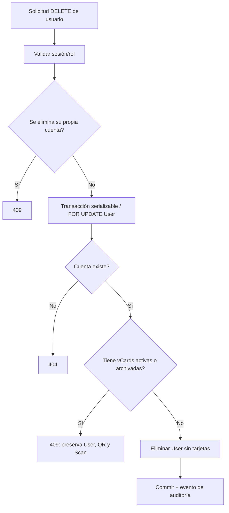

# PR-16 — Retención segura al eliminar usuarios y edición sin reactivaciones accidentales
Fecha 2026-10-27. Basado en #15 → #14 → #13 → #12 → #11 → #10. No cambia Prisma schema ni producción.

## Causa raíz
- `DELETE /api/users/:id` llamaba directamente `prisma.user.delete`. Por `VCard.user onDelete: Cascade` y `Scan.vcard onDelete: Cascade`, esto podía eliminar vCards, QR y sus escaneos históricos sin advertencia, incluso archivados.
- Una verificación suelta de `_count.vcards` seguida de un DELETE no basta ante inserciones simultáneas. El usuario puede recibir una nueva VCard entre ambos pasos.
- `PUT /api/users/:id` asignaba `isActive: true` cuando se omitía el campo, reactivando sin intención cuentas suspendidas, y `branchId: null` cuando se omitía el ID.

## Modificaciones
1. Nuevo `lib/user-retention.ts`: `deleteUnlinkedUser(prisma,id)` ejecuta transacción serializable con `SELECT ... FOR UPDATE` del registro User, consulta su conteo total de vCards (activas y archivadas) y solo permite borrar un usuario **sin tarjetas**.
2. API DELETE exige rol administrativo, bloquea el borrado de la propia cuenta, responde 409 `USER_HAS_VCARDS` sin alterar la BD, 404 si no existe y 409 ante colisión serializable P2034.
3. Las relaciones FK toman bloqueo de referencia sobre la fila padre, impidiendo que una nueva inserción de VCard cruce sin control la verificación y el DELETE dentro de la transacción.
4. PUT de usuarios conserva `branchId`, `photoUrl` e `isActive` cuando el cliente no los suministra. No reactiva usuarios inactivos al editar otro campo.
5. La grabación de auditoría después del commit conserva respuesta de éxito aun si falla el transporte de auditoría (se registra el problema en log); no solicita repetir un DELETE ya efectuado.
6. Prueba real de PostgreSQL CI exige que una cuenta con VCard se mantenga y conserve al menos un Scan después del intento de eliminación.

## App Flow

## QA antes de integrar
- `npm ci`, `npx prisma validate`, `npx prisma generate`, `npm run typecheck`, `npm test`, PostgreSQL Integration CI, `npm run lint`, `npm run build` aprobados en último SHA.
- User con 1 VCard activa + 3 Scan: DELETE 409, nada borrado.
- User con VCard archivada: DELETE 409, nada borrado.
- User sin VCard: DELETE permitido si rol lo autoriza; comprobar auditoría y otras relaciones dependientes.
- Autodelete con sesión propia: 409. Roles no administradores: 403.
- Prueba de concurrencia real con dos transacciones HTTP: intento de crear tarjeta mientras se solicita eliminar el mismo usuario; nunca perder QR ni Scan por carrera.
- PUT parcial de nombre sin isActive/branchId/photoUrl: conserva estado, sede y foto.
- Confirmar que cambios no afectan sesiones existentes indebidamente (desactivar no equivale necesariamente a revocar JWT ya emitido; estudiar revocación de sesión en fase posterior).
- Probar recuperación y continuidad de QR firmado en V1/V2 y sistema 9301/9306 usando una base aislada.

## Deudas / límites
- El bloqueo impide eliminar usuarios con vCards, pero la retención de otros registros relacionados con usuarios sin vCards (auditoría, sesiones, cuentas OAuth) exige revisión separada.
- No se ha implementado un proceso de traslado o anonimización legalmente revisado ni un flujo de eliminación de datos personales. El administrador puede desactivar la cuenta mediante edición existente.
- No se ha aplicado ningún cambio a la IP ni la BD de producción, ni se ha ejecutado una prueba de navegador en el servidor real.

## Rollback
Revertir commits o release anterior. Revertir código no deshace eliminaciones posteriores; conservar exportación y pruebas de restauración antes de implementar un despliegue real.
