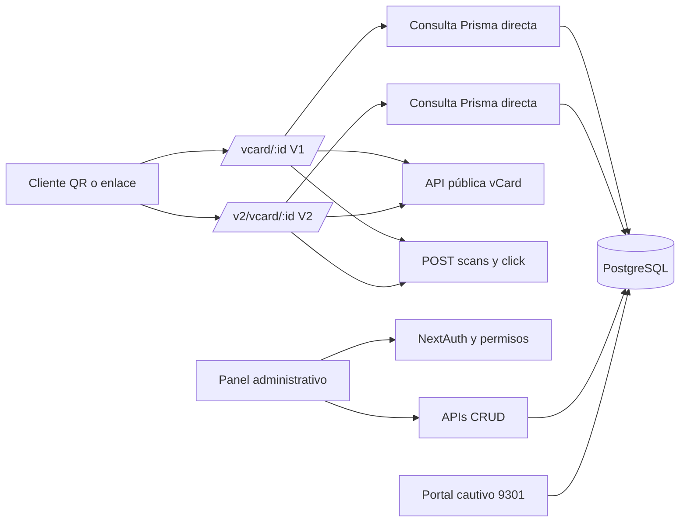
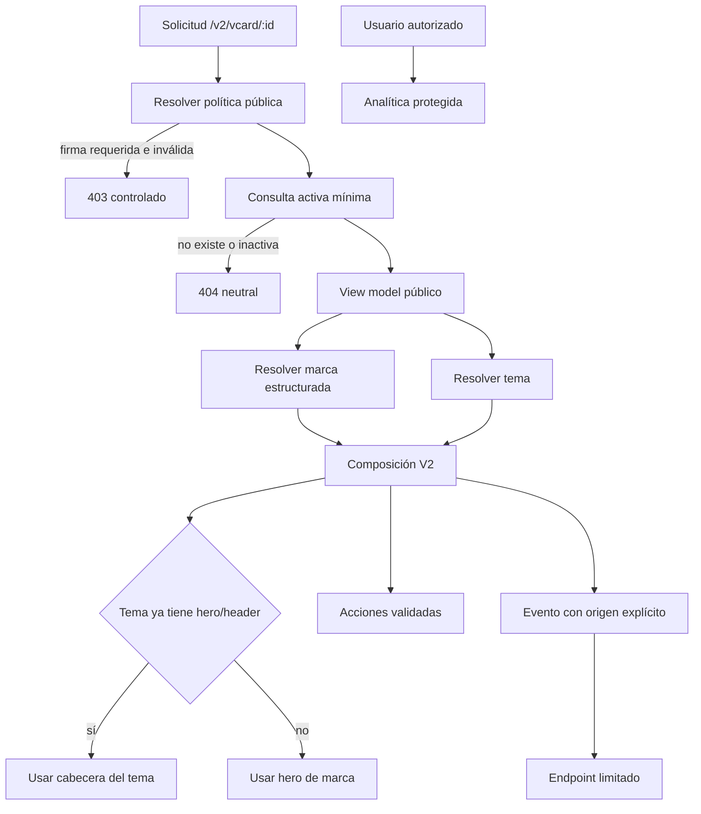

# TRD — Arquitectura técnica VCards V2

## Baseline auditado

La instantánea contiene Next.js 14.2.28, React 18, TypeScript 5.2, Tailwind 3, Prisma 6, PostgreSQL y NextAuth. El proyecto suma aproximadamente 29 204 líneas en TypeScript, TSX, Prisma y CSS. No se encontraron pruebas `*.test.*`, `*.spec.*`, directorios `__tests__` ni migraciones Prisma.

El despliegue observado se divide así:

- 9301: `/home/yc/vcard-system`, portal/administración, sin V2.
- 9306: `/home/yc/vcards-fase1-20261014-101842`, aplicación independiente con V2.
- Baseline adicional: `/home/yc/vcard-system-9306`, sin V2.

Los árboles desplegados no contienen `.git`. El repositorio local es, por tanto, la superficie correcta para rama, commits y PR; el servidor solo sirve como fuente de evidencia y validación de lectura.

## Arquitectura actual

## Componentes principales

| Área | Archivos representativos | Responsabilidad |
|---|---|---|
| Render V1 | `app/vcard/[id]/page.tsx`, `client-page.tsx` | SSR, selección de tema y acciones públicas |
| Render V2 | `app/v2/vcard/[id]/page.tsx`, `client-page.tsx` | Copia de V1 más hero y correo contextual |
| Tema runtime | `app/components/vcard-theme-runtime.tsx` | Render de bloques configurables y animaciones |
| Hero V2 | `app/components/automotive-brand-hero.tsx` | Presentación Ford/GAC/Quick Lane |
| API pública | `app/api/vcard/[id]/*` | Datos y descarga VCF |
| Analítica | `app/api/vcards/scans`, `click` | Registro y lectura de visitas/acciones |
| Datos | `prisma/schema.prisma`, `lib/prisma.ts` | Modelos y cliente PostgreSQL |
| Seguridad | `lib/security.ts`, `lib/auth.ts`, `lib/permissions.ts` | Firma, sesión, roles y 2FA |

## Arquitectura objetivo

## Decisiones propuestas

### ADR-01: política pública compartida

Extraer una función server-side usada por SSR, API y descarga que valide firma cuando esté habilitada, filtre `VCard.isActive` y `User.isActive` y devuelva solo campos públicos. Evita que SSR eluda `lib/security.ts`.

### ADR-02: composición, no duplicación

Separar `PublicVCardShell`, `BrandHero`, `ThemeLayout` y `VCardActions`. El compositor detecta bloques de cabecera en el tema y elige una sola fuente visual. V1 no se importa ni modifica.

### ADR-03: marca estructurada

Resolver una unión cerrada `FORD | GAC | QUICK_LANE | GENERIC` desde `Company.slug` o un campo estable. El análisis del nombre queda únicamente como compatibilidad temporal y retorna `GENERIC` ante ambigüedad.

### ADR-04: taxonomía única de puesto

Centralizar `positionGroup` y plantillas de correo. La misma clasificación alimenta tema y correo; debe contemplar acentos, sinónimos y fallback neutral. A futuro debería almacenarse como dato estructurado.

### ADR-05: telemetría minimizada

El origen de visita llega como parámetro controlado o contexto firmado; el endpoint valida valores. El `GET` de analítica exige permiso. Las respuestas de escritura no devuelven IP, agente ni ubicación.

### ADR-06: agenda desacoplada

Definir un puerto `SchedulingProvider` sin implementación productiva. Hasta disponer del contrato, la UI muestra estado pendiente o canal aprobado. No persistir citas falsas.

## Modelo de datos

No se propone migración en la fase visual. El esquema existente incluye User, Company, Branch, VCard, Scan, Theme y VCardPositionThemeRule. Toda evolución posterior requiere migraciones versionadas; hoy `prisma/` solo contiene `schema.prisma`, lo que bloquea reproducibilidad segura.

## Contratos públicos

| Operación | Estado objetivo |
|---|---|
| `GET /v2/vcard/:id` | Solo tarjeta y usuario activos; política de firma coherente |
| `GET /api/vcard/:id` | View model público mínimo; sin secretos/configuración innecesaria |
| Descarga VCF | Sin efecto lateral por GET o con métrica separada idempotente |
| `POST /api/vcards/scans` | Origen validado, rate limit fiable, respuesta mínima |
| `POST /api/vcards/click` | Tipo permitido, rate limit y respuesta mínima |
| `GET /api/vcards/scans` | Sesión y permiso obligatorios |

## Seguridad

- No confiar en `x-forwarded-for` salvo detrás de proxy conocido.
- Comparar firmas en tiempo constante y no guardar la firma intentada completa.
- Permitir únicamente `https:`, `mailto:`, `tel:` y `sms:` según tipo de acción.
- Evitar logging de query strings completas con MAC, URL de continuidad u otros datos.
- Añadir CSP, `X-Content-Type-Options`, política de referrer y desactivar `X-Powered-By`, validando primero el proxy externo.
- Separar backups con PII del árbol de aplicación, cifrarlos y limitar retención/acceso.

## Observabilidad

- Correlation ID sin PII.
- Métricas separadas para render, descarga, acción y origen.
- Endpoint de salud sin acceso a datos personales.
- Errores públicos neutrales; diagnóstico detallado solo en logs protegidos.

## Deuda confirmada

- Duplicación byte a byte de las páginas server V1/V2.
- Clientes Prisma duplicados en `lib/prisma.ts` y `lib/db.ts`.
- 510 coincidencias aproximadas de `any`, `@ts-ignore` o `@ts-nocheck`.
- Archivos monolíticos de hasta 2 380 líneas.
- Build configurado para omitir lint.
- Mezcla Next 14, ESLint 9 y `eslint-config-next` 15 pendiente de compatibilidad.

## Incertidumbres y bloqueos

- Compartición real de PostgreSQL entre 9301 y 9306: sospecha, no confirmada porque no se leyeron `.env`.
- Cabeceras del proxy público: deben verificarse externamente antes de cerrar el hallazgo.
- No existe contrato CRM, por lo que no puede definirse adaptador productivo.

