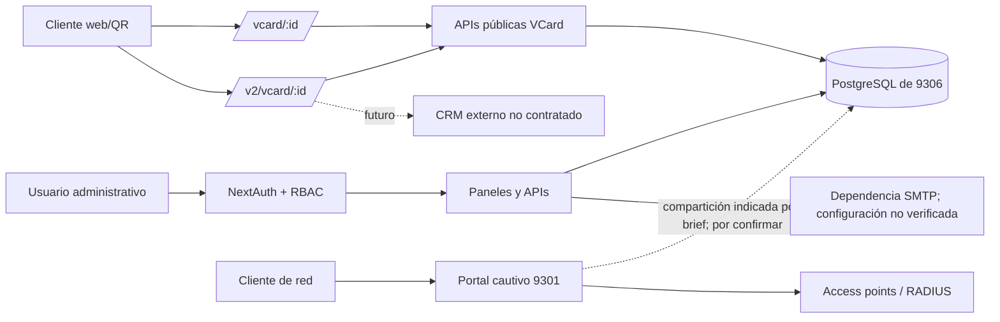
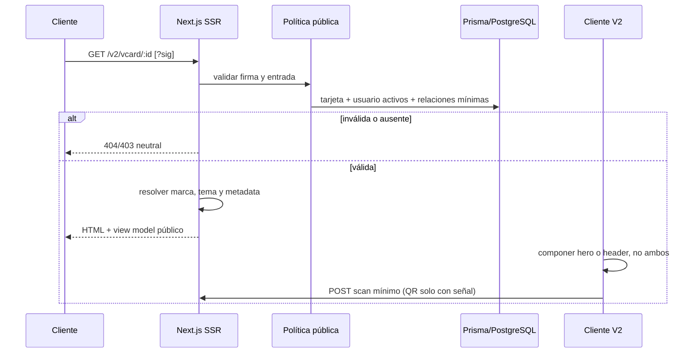

# TRD — Plataforma VCards y V2

## Control y fuentes

- Fecha: 2026-10-15.
- Fuentes: brief, chat «Diseñar App Flow V2», código recuperado y auditoría de solo lectura de 9301/9306.
- Convención: **actual** describe código observado; **implementado en rama** describe el PR; **futuro** no debe interpretarse como existente.

## Arquitectura auditada

Aplicación monolítica Next.js 14.2.28/React 18/TypeScript, con App Router, Tailwind, Prisma 6, PostgreSQL y NextAuth. El mismo árbol contiene administración, VCards, marketing y portal cautivo.

| Instancia | Directorio observado | Rol | Restricción |
|---|---|---|---|
| 9301 | `/home/yc/vcard-system` | Portal cautivo/administración legado, sin V2 | No modificar/reiniciar |
| 9306 | `/home/yc/vcards-fase1-20261014-101842` | Producción observada con V2 | No desplegar sin autorización |
| Baseline | `/home/yc/vcard-system-9306` | Copia adicional sin V2 | Solo evidencia |

Los directorios del servidor no tenían `.git`; el repositorio GitHub recuperado es la fuente versionada candidata. La compartición de `vcard_db` entre 9301/9306 es un riesgo indicado por el brief, no se confirmó leyendo secretos.

## Vista de contexto



## Dominios y módulos

| Dominio | UI | API/servicios | Datos principales |
|---|---|---|---|
| Autenticación | `/login`, recuperación | `/api/auth/*`, 2FA | User, Account, Session, VerificationToken |
| Organización | usuarios, ubicaciones, compañías/sucursales | `/api/users`, `/companies`, `/branches` | User, Company, Branch, AuditLog |
| VCards | `/vcards/*`, V1 y V2 públicas | `/api/vcards*`, `/api/vcard/[id]` | VCard, Scan, reglas de tema |
| Temas/marketing | temas, editores, banners, promociones, enlaces | `/api/themes`, `/banners`, `/promotions`, `/portal-links` | Theme, Banner, Promotion, CaptivePortalLink |
| Portal cautivo | portal, acceso, internet, configuración | `/api/portal*`, `/radius`, `/access-points` | PortalConfig, PortalSession, AccessPoint |
| Operación | dashboard, analítica, reportes, logs, backup | `/api/dashboard`, `/analytics`, `/reports`, `/logs`, `/backup` | Agregaciones y AuditLog |

## Matriz de estado

| Capacidad | 9306 observado | Rama del PR | Futuro/bloqueado |
|---|---|---|---|
| V1 | Publicada | Sin cambio intencional | Endurecimiento solo con plan compatible |
| V2 | Publicada con defectos auditados | Composición, marca, acciones y controles corregidos | UAT y despliegue autorizados |
| Firma V2 | Política parcial | HMAC coherente en V2/API/VCF | Rotación, expiración y migración de QR |
| Atribución | Todo podía verse como QR | Heurística `sig`=QR, sin `sig`=DIRECT | Token de origen separado y no propagable |
| Agenda | Sin CRM real | `mailto:` técnicamente disponible | Aprobación negocio; luego CRM/HTTPS |
| Portal 9301 | Operativo, fuera de alcance | Sin cambios | Separación por evaluar |

## Modelo de ejecución pública V2



## Resolución de tema

Orden observado y preservado:

1. regla activa por cargo;
2. temporada vigente de sucursal;
3. tema normal de sucursal;
4. temporada vigente de compañía;
5. tema predeterminado de compañía;
6. tema global activo;
7. tema legado/fallback.

La composición V2 inspecciona bloques `Header`/`SeasonalHero`. Si existen, omite `AutomotiveBrandHero`; si no, usa hero por marca. V1 no se reutiliza ni se altera.

## Componentes del PR

| Componente | Responsabilidad |
|---|---|
| `lib/vcard-profile.ts` | Resolver marca, grupo de cargo, borradores de correo/agenda y URLs seguras |
| `app/v2/vcard/[id]/page.tsx` | Política server-side, consulta activa, metadata y 404 neutral |
| `app/v2/vcard/[id]/client-page.tsx` | Composición, acciones y telemetría de origen |
| `automotive-brand-hero.tsx` | Hero Ford/GAC/Quick Lane/genérico |
| `vcard-theme-runtime.tsx` | Layout de tema, agenda delegada y reducción de movimiento |
| `lib/security.ts` | Verificación de firma en tiempo constante |
| fixture visual protegida | Evidencia con datos ficticios; deshabilitada por defecto |

## Contratos públicos

| Contrato | Autorización | Regla objetivo/implementada |
|---|---|---|
| `GET /vcard/:id` | Pública | V1 estable; sin redirección |
| `GET /v2/vcard/:id` | Pública condicionada | Tarjeta/usuario activos y firma coherente |
| `GET /api/vcard/:id` | Pública condicionada | View model mínimo y activos |
| descarga VCF | Pública condicionada | Misma política de firma/actividad |
| `POST /api/vcards/scans` | Pública limitada | Origen validado, respuesta `scanId` mínima |
| `POST /api/vcards/click` | Pública limitada | Tipo permitido y respuesta mínima |
| `GET /api/vcards/scans` | Privada | Sesión y permiso VCards |
| CRUD administrativo | Privada | NextAuth + permisos por módulo |

### Contrato provisional de firma

- Aplica en esta rama a V2 SSR, API pública VCard y descarga VCF; V1 no se endurece para no romper QR.
- Se activa con `REQUIRE_VCARD_SIGNATURE=true`; desactivada, la ausencia de `sig` es válida.
- Si hay `sig`, se espera HMAC-SHA256 hexadecimal de `vcardId` con el secreto configurado y comparación en tiempo constante.
- No incorpora expiración, versión ni rotación. Activar exigencia en producción requiere inventario de QR/enlaces, compatibilidad y rollback.
- Pendiente crítico: no registrar una firma intentada completa en auditoría.

SSR V2 usa 404 para política/actividad inválida y ciertas APIs usan 403. Unificar el contrato sin facilitar enumeración es una decisión previa a despliegue.

## Datos

Modelos reales: Account, Session, VerificationToken, User, Company, Branch, VCardPositionThemeRule, VCard, Scan, Theme, AccessPoint, Promotion, Banner, CaptivePortalLink, AuditLog, PortalConfig y PortalSession.

No hay migración en esta fase. No se añade tabla para agenda. El árbol recuperado no incluye historial de migraciones Prisma reproducible, por lo que cualquier evolución futura requiere baseline, backup probado y migración versionada.

## Agenda futura

```ts
interface SchedulingProvider {
  getAvailability(input: AvailabilityRequest): Promise<Slot[]>;
  createRequest(input: AppointmentRequest, idempotencyKey: string): Promise<AppointmentResult>;
  getStatus(externalId: string): Promise<AppointmentStatus>;
}
```

Este contrato es conceptual. Faltan proveedor, URLs, autenticación, SLA, estados, cancelación, reintentos, webhooks, consentimiento y retención. La rama actual solo genera un `mailto:` editable.

## Seguridad y privacidad

- Filtrado server-side de tarjeta y usuario activos.
- Firma aplicada a SSR/API/descarga y comparación constante.
- Esquemas permitidos por tipo de acción; rechazo de `javascript:`/`data:`.
- Lectura de analítica autenticada y respuesta pública mínima.
- No confiar en `x-forwarded-for` sin proxy conocido.
- Pendientes: CSP, cabeceras, hardening de iframes/HTML configurable, rate limit distribuido y actualización controlada de dependencias.
- No almacenar solicitudes de cita antes de HTTPS, contrato, consentimiento y política de retención.

## Rendimiento y accesibilidad

- Mobile-first; anchos de prueba 360/390/768/1024/1440.
- Contenedor de lectura limitado en escritorio.
- `prefers-reduced-motion` desactiva animación no esencial.
- Objetivo táctil 44×44, foco visible, un `h1`, alt text y contraste AA.
- Deuda: múltiples `` heredados y optimización Next Image pendiente.

## Despliegue y rollback

El PR no cambia producción. Una liberación futura exige aprobación, backup verificable, checkout/build fuera del directorio activo, configuración secreta externa, publicación atómica, health checks V1/V2/9301 y rollback al build anterior. No ejecutar migraciones.

## Calidad

- `npm test`: pruebas unitarias de marca, cargo, mailto y URL.
- `npm run typecheck`, `npm run lint`, `npm run build`.
- Evidencia visual de tres marcas por cinco viewports y movimiento reducido.
- Regresión V1 y no impacto 9301 como puertas de liberación.
- Evidencia: `AUDIT_FINDINGS.md`, `QA_TEST_PLAN.md` y `evidence/visual/`. Implementado no equivale a validado en producción.

## Deuda y riesgos priorizados

| Prioridad | Riesgo | Tratamiento |
|---|---|---|
| P0 | PostgreSQL potencialmente compartido | No migrar; confirmar topología con DBA |
| P0 | Vulnerabilidades transitivas, incluidas críticas | Rama dedicada, pruebas y actualización no forzada |
| P0 | HTML/iframe/URL configurables | Sanitización, allowlist y CSP |
| P1 | Monolito con dominios operativos distintos | ADR de separación y contratos internos |
| P1 | Prisma duplicado y páginas V1/V2 copiadas | Repositorio/servicio público compartido sin cambiar UI V1 |
| P1 | Archivos monolíticos y tipos débiles | Refactor incremental con cobertura |
| P2 | Observabilidad limitada | Correlation ID, métricas y logs sin PII |

## Incertidumbres explícitas

- No se leyó `.env`; la URL y usuario reales de BD no están documentados aquí.
- No existe contrato CRM.
- No se verificaron derechos de assets de marca.
- Proxy/TLS y cabeceras finales deben auditarse desde el punto público antes de liberar.
