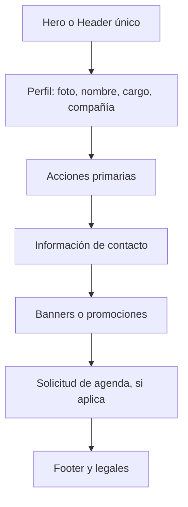

# UI/UX Design — VCards V2

## Principios

1. Identidad antes que decoración: marca, persona y cargo deben entenderse en tres segundos.
2. Una sola cabecera: el hero de marca y el encabezado del tema son alternativas, no capas acumulativas.
3. Acciones inmediatas: teléfono, WhatsApp, correo y guardar contacto aparecen en la primera pantalla móvil cuando existen.
4. Movimiento con propósito: animaciones cortas, no bloqueantes y desactivables.
5. Estado honesto: una solicitud de agenda no equivale a una cita confirmada.

## Jerarquía propuesta

## Sistema por marca

| Marca | Base | Acento | Tono | Regla de fallback |
|---|---|---|---|---|
| Ford Yude | Azul corporativo | Azul claro | Confianza y trayectoria | Solo si la compañía está identificada como Ford |
| GAC Yude | Grafito | Rojo | Tecnología y precisión | Solo si la compañía está identificada como GAC |
| Quick Lane | Azul oscuro | Naranja | Rapidez y servicio | Solo si la compañía está identificada como Quick Lane |
| Genérica | Gris profundo | Color de sucursal | Neutral | Ante dato ausente o ambiguo |

Los colores finales deben contrastarse con WCAG; los valores actuales del hero son punto de partida, no aprobación final.

## Responsive

| Viewport | Composición esperada |
|---|---|
| 360 px | Una columna, padding 16 px, acciones 2×N o lista, texto sin truncamiento crítico |
| 390 px | Igual a 360 con respiración adicional; CTA principal visible sin scroll excesivo |
| 768 px | Tarjeta centrada, banner proporcional, máximo dos columnas internas |
| 1024 px | Contenedor contenido; no estirar la vCard como dashboard |
| 1440 px | Fondo de marca y tarjeta focal; ancho de lectura controlado |

## Hero y banners

- Relación visual estable; imagen con `object-fit: cover` y punto focal configurable.
- Overlay suficiente para contraste.
- Texto esencial nunca incrustado dentro de la imagen.
- Si el tema contiene `Header` o `SeasonalHero`, no renderizar `AutomotiveBrandHero` adicional.
- No usar imagen de tema como hero y fondo completo simultáneamente si reduce legibilidad.

## Acciones

- Orden recomendado: Llamar, WhatsApp, Correo, Guardar, Compartir.
- Ocultar acciones sin dato; no mostrar botones inertes.
- Icono acompañado de texto, foco visible y área mínima 44×44 px.
- WhatsApp debe normalizar país de forma explícita; eliminar caracteres no basta para números locales.
- Correo utiliza una plantilla basada en grupo de puesto y siempre permite edición en el cliente de correo.

## Agenda pendiente

Estado actual permitido:

- “Solicitar cita” enlaza a un canal aprobado, o
- “Agenda en preparación” comunica indisponibilidad sin capturar datos.

No mostrar selector de horarios, confirmación o folio mientras no exista contrato CRM y respuesta real del proveedor.

## Estados

| Estado | Diseño |
|---|---|
| Cargando | Skeleton estable, no spinner indefinido como única señal |
| No encontrada/inactiva | Mensaje neutral, sin revelar existencia previa |
| Error temporal | Mensaje distinto, opción de reintento y referencia de soporte |
| Sin imagen | Iniciales y color de marca; sin círculo vacío |
| Acción fallida | Feedback no bloqueante; conservar contexto |
| Offline | Datos disponibles ya renderizados y acciones locales cuando sea posible |

## Accesibilidad

- Un solo `h1` con el nombre de la persona; jerarquía subsecuente ordenada.
- Texto alternativo descriptivo para logotipo, foto y banners enlazados.
- Respeto global a `prefers-reduced-motion`, incluyendo animaciones configuradas por tema.
- No depender solo del color para marca, estado o acción.
- Navegación completa por teclado y lector de pantalla.
- Zoom al 200 % sin pérdida de contenido.

## Hallazgos visuales confirmados

- V2 siempre renderiza `AutomotiveBrandHero` antes del layout dinámico; un tema con `Header` o `SeasonalHero` produce dos cabeceras.
- Cualquier marca no reconocida se clasifica como Ford.
- Metadata y varios fallbacks muestran Ford incluso para otras marcas.
- El runtime de temas define animaciones sin reducción de movimiento.
- El fallback sin logo contiene un círculo vacío.

## Evidencia visual requerida

Matriz obligatoria: Ford, GAC y Quick Lane × 360, 390, 768, 1024 y 1440 px. Para cada captura registrar URL anonimizada, commit, navegador, viewport, fecha, estado de datos y resultado. También capturar teclado, movimiento reducido, tarjeta sin imagen, inexistente/inactiva y error 5xx simulado.

No existe todavía evidencia de que esta matriz haya pasado.

