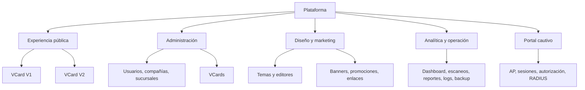

# UI/UX Design — Plataforma VCards

## Control

- Actualización: 2026-10-15.
- Fuentes: brief, chat de App Flow, inventario del producto y evidencia visual de la rama.
- Alcance implementado: experiencia pública `/v2/vcard/[id]`.
- Alcance definido, no rediseñado en esta fase: administración, editores, analítica y portal cautivo.

## Principios de experiencia

1. **Identidad inmediata:** marca, persona y cargo se comprenden en tres segundos.
2. **Una acción, un resultado:** cada CTA describe exactamente lo que ocurrirá.
3. **Una sola cabecera:** hero de marca y encabezado del tema son alternativas.
4. **Mobile-first real:** el flujo esencial cabe y funciona desde 360 px.
5. **Estado honesto:** solicitar no significa confirmar; pendiente no significa error.
6. **Accesibilidad por defecto:** teclado, contraste, foco, semántica y movimiento reducido.
7. **Consistencia administrativa:** patrones compartidos para listas, editores, formularios y estados.
8. **Seguridad perceptible:** no revelar existencia de tarjetas inactivas ni pedir PII en HTTP.

## Arquitectura de información



## Experiencia pública V2

### Jerarquía

1. Hero/header único con identidad de marca.
2. Foto o iniciales, nombre, cargo y compañía.
3. Acciones primarias: llamar, WhatsApp y correo.
4. Acciones utilitarias: guardar y compartir.
5. Información de contacto y ubicación disponible.
6. Banners/promociones del tema.
7. Solicitud de cita, si existe canal aprobado.
8. Footer, privacidad y soporte.

### Wireframe móvil

```text
┌──────────────────────────────┐
│ HERO O HEADER ÚNICO          │
│ marca + mensaje              │
├──────────────────────────────┤
│        [foto/iniciales]      │
│ Nombre Apellido              │
│ Cargo · Compañía             │
├──────────────────────────────┤
│ [Llamar] [WhatsApp] [Correo] │
│ [Guardar contacto] [Compartir]│
├──────────────────────────────┤
│ Datos de contacto            │
│ Ubicación / sitio            │
├──────────────────────────────┤
│ Banner o promoción           │
├──────────────────────────────┤
│ [Solicitar cita]             │
│ No constituye confirmación   │
└──────────────────────────────┘
```

### Variantes por marca

Los tokens son direcciones de diseño sujetas a aprobación de marca, no una licencia de uso.

| Token | Ford Yude | GAC Yude | Quick Lane | Genérico |
|---|---|---|---|---|
| Primario | azul profundo | grafito | azul oscuro | gris pizarra |
| Acento | azul luminoso | rojo | naranja | color configurado |
| Personalidad | confianza y trayectoria | precisión y tecnología | rapidez y servicio | neutral y profesional |
| Superficie | azul/blanco limpio | blanco/grafito técnico | azul/blanco con señal naranja | neutra |
| Movimiento | recorrido sutil | entrada precisa | desplazamiento ágil | fundido mínimo |
| Fallback | solo Ford identificado | solo GAC identificado | solo Quick Lane identificado | dato ausente/ambiguo |

Antes de liberar: validar valores finales, contraste y assets oficiales con Marketing/Legal.

## Sistema de diseño

### Tipografía

- Fuente del sistema o fuente corporativa aprobada; no bloquear render por fuente remota.
- Nombre: 28–36 px móvil, peso 700, altura 1.1–1.2.
- Cargo/compañía: 15–18 px, altura mínima 1.4.
- Texto: mínimo 16 px para contenido y controles.
- Etiquetas auxiliares: mínimo 12–14 px con contraste AA.

### Espaciado y forma

- Base: 4 px; escala preferida 4, 8, 12, 16, 24, 32, 48.
- Padding móvil: 16 px; tablet: 24 px; escritorio: 24–32 px.
- Separación entre CTAs: mínimo 8 px.
- Objetivo táctil: mínimo 44×44 px.
- Radio: 12–20 px en tarjetas, 999 px solo en chips/acciones circulares.
- Sombra: una elevación principal; no apilar efectos decorativos.

### Breakpoints de validación

| Ancho | Composición |
|---|---|
| 360 | Una columna; acciones ajustables; cero overflow |
| 390 | CTA principal visible con respiración adicional |
| 768 | Tarjeta centrada; hasta dos columnas internas |
| 1024 | Contenedor contenido, no apariencia de dashboard |
| 1440 | Fondo de marca y foco central con ancho de lectura controlado |

## Componentes públicos

| Componente | Variantes | Estados |
|---|---|---|
| BrandHero | Ford/GAC/Quick Lane/genérico | imagen, degradado, sin asset |
| Profile | foto, iniciales | completa, sin foto, datos parciales |
| ActionButton | primaria, secundaria, utilitaria | default, hover, focus, active, disabled/oculta |
| ContactDetail | teléfono, correo, sitio, dirección | visible u omitido |
| Banner | móvil/tablet/escritorio | vigente, fallback, oculto |
| ScheduleCTA | correo aprobado, preparación | disponible, bloqueado, error local |
| Feedback | toast/estado inline | éxito, aviso, error |

## Acciones y microcopy

| Acción | Etiqueta | Resultado |
|---|---|---|
| Teléfono | Llamar | Abre `tel:` |
| WhatsApp | WhatsApp | Abre conversación con número normalizado |
| Email | Escribir correo | Abre borrador editable por cargo |
| VCF | Guardar contacto | Descarga `.vcf` validado |
| Share | Compartir | Web Share o copia enlace |
| Agenda actual en rama | Solicitar cita | Borrador; no confirma; ocultar hasta aprobación de negocio |
| Agenda futura | Elegir horario | Solo tras disponibilidad CRM real |

Evitar “Cita confirmada”, “Reservado” o un folio simulado.

## Estados públicos

| Estado | Comportamiento | Mensaje orientativo |
|---|---|---|
| Loading | Skeleton estable | Sin mensaje obligatorio |
| Lista | Render completo | — |
| Sin foto | Iniciales y color de marca | — |
| Dato ausente | Omitir acción/campo | — |
| No encontrada/inactiva | Respuesta neutral | “Esta tarjeta no está disponible” |
| Firma inválida | Respuesta neutral, sin detalle criptográfico | “No se pudo abrir este enlace” |
| Error temporal | Reintento y referencia | “Intenta nuevamente” |
| Offline | Conservar lo ya renderizado y acciones locales | “Sin conexión” cuando aplique |
| Acción fallida | Feedback no bloqueante | “No fue posible completar la acción” |

## Experiencia administrativa objetivo

No se implementa en este PR, pero establece coherencia futura.

### Navegación

- Nivel 1: Inicio, Organización, VCards, Diseño/Marketing, Portal, Analítica, Operación.
- Nivel 2 contextual; no mezclar “temas de portal” con “temas de VCard” sin etiqueta explícita.
- Breadcrumb en editores profundos.
- Mostrar compañía/sucursal activa cuando afecte datos.

### Patrón de listado

- Título, descripción breve y CTA principal.
- Filtros persistentes y búsqueda con etiqueta.
- Tabla en escritorio; tarjetas o tabla desplazable accesible en móvil.
- Estado activo/inactivo con texto, no solo color.
- Acciones destructivas separadas y confirmadas.
- Loading, vacío, error y sin permisos diferenciados.

### Patrón de formulario/editor

- Guardado explícito y estado de cambios sin guardar.
- Validación cercana al campo y resumen al enviar.
- Preview no sustituye validación real.
- Editor de temas con estructura, estilo, contenido y preview separados.
- Cambios de alcance compañía/sucursal/cargo claramente visibles.

### Analítica y operación

- Filtros con rango/zonahoraria visibles.
- Diferenciar métricas de QR, directo y manual.
- No mostrar PII salvo permiso y propósito documentado.
- Exportación y backup con alcance, fecha y riesgo explícitos.

## Portal cautivo

El portal 9301 está fuera del rediseño. Sus flujos deben mantener identidad propia y evitar componentes VCard que introduzcan regresiones. Cualquier unificación futura debe comenzar por tokens compartidos, no por fusionar rutas o despliegues.

## Accesibilidad — objetivo WCAG 2.2 AA

No constituye certificación. Teclado, zoom, lectores de pantalla y contraste requieren UAT formal antes de liberar.

- Un solo `h1` público con el nombre de la persona.
- Orden de encabezados y landmarks correcto.
- Foco visible con contraste mínimo 3:1.
- Texto y componentes con contraste AA.
- Iconos acompañados por nombre accesible.
- Alt text útil; decoraciones con alt vacío.
- Zoom 200 % y reflow sin pérdida.
- Teclado completo y sin trampas de foco.
- Errores anunciados con `aria-live` cuando corresponda.
- `prefers-reduced-motion` elimina desplazamientos, autos y transformaciones no esenciales.

## Movimiento

- Duración normal: 160–300 ms; entrada de hero hasta 500 ms si no bloquea contenido.
- Animar `opacity` y `transform`; evitar propiedades de layout.
- No repetir movimiento decorativo indefinido cerca de texto/CTA.
- Pausar o eliminar video/auto animado con movimiento reducido.
- La información nunca depende de animación.

## Rendimiento visual

- Reservar proporción de imagen para evitar CLS.
- Usar variantes responsive y formatos optimizados.
- No incrustar texto esencial en banners.
- Cargar hero prioritario solo cuando sea LCP real.
- Lazy-load de contenido bajo el primer viewport.

## Evidencia y aceptación

- Capturas Ford, GAC y Quick Lane en 360, 390, 768, 1024 y 1440.
- Captura adicional Ford 390 con movimiento reducido.
- Revisar teclado, 200 % zoom, sin foto, datos faltantes, 404, firma inválida y error temporal.
- La evidencia actual usa fixture ficticia protegida y no prueba assets/datos productivos.
- UAT final exige tarjetas de prueba autorizadas y aprobación de Marketing/Legal.

## Decisiones pendientes

1. Assets y guía corporativa oficial de cada marca.
2. Taxonomía empresarial definitiva de cargos.
3. Canal alternativo de agenda permitido antes del CRM.
4. Texto legal/privacidad para analítica y futura captura de datos.
5. Alcance de un futuro rediseño administrativo.
